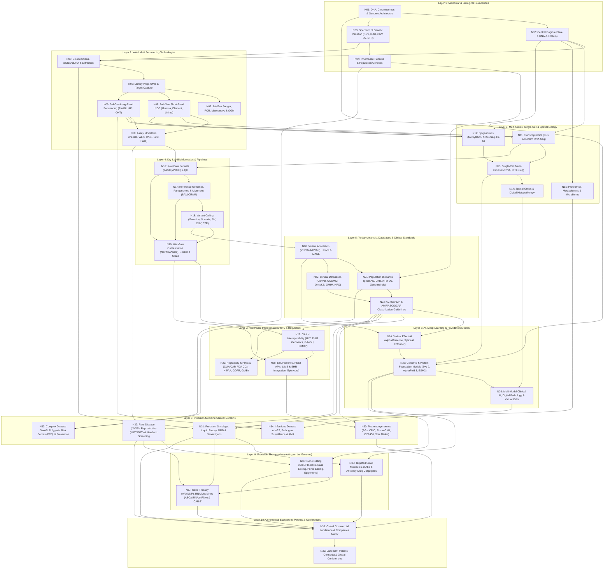

# 🧬 The Complete Genomics to Precision Medicine Atlas
### *An End-to-End Interactive Knowledge Graph, Conceptual Encyclopedia & Google Antigravity Web-App Specification*

---

## 📖 Part 1: Conceptual Foundation — What Are Genomics and Precision Medicine?

### 1. What is Genomics? (Reading the Book of Life)
Every human body is made of roughly $3 \times 10^{13}$ cells, and inside almost every cell sits the **genome**: a complete biochemical instruction manual written in a four-letter chemical alphabet—**Adenine ($A$), Thymine ($T$), Cytosine ($C$), and Guanine ($G$)**—spanning roughly $3.2 \times 10^9$ base pairs (per haploid copy) coiled into $23$ pairs of chromosomes.

* **Genetics vs. Genomics:** While traditional *genetics* studies single genes and how traits or rare disorders pass from parent to child in isolation, **genomics** is the comprehensive study of the **entire genome**—all $\sim 20,000$ protein-coding genes, the remaining $98.5\%$ non-coding regulatory DNA, structural architecture, 3D folding, epigenetic chemical tags, and how all of these elements interact dynamically with each other and the environment.
* **The Engineering Challenge:** Reading a human genome requires converting invisible molecules inside a tube of blood, saliva, or tumor tissue into hundreds of gigabytes of digital text (`FASTQ` files), aligning millions of short or long DNA fragments to a reference coordinate map (`BAM`/`CRAM` files), identifying the $\sim 4$ to $5 \times 10^6$ places where an individual differs from the reference genome (`VCF` files), and separating harmless human diversity from disease-causing mutations.

### 2. What is Precision Medicine? (Acting on the Blueprint)
Historically, medicine operated on a **"one-size-fits-all" (population-average)** model: two patients with the same symptom or tumor location received the exact same drug and dose. Yet in reality, one patient might be cured, another might see zero benefit, and a third might suffer a fatal adverse drug reaction.

**Precision Medicine** (often coupled with *Personalized* or *Genomic Medicine*) is a clinical paradigm that tailors disease prevention, diagnosis, prognosis, drug selection, dosing, and therapy design to the unique molecular, genetic, multi-omic, environmental, and clinical profile of each individual patient:
1. **Right Patient, Right Diagnosis:** Identifying the exact molecular root cause of a rare pediatric syndrome or sub-typing a tumor by its genetic driver (e.g., an $EGFR$ L858R mutation) rather than just its organ of origin.
2. **Right Drug, Right Dose (Pharmacogenomics):** Checking a patient's drug-metabolizing genes (such as $CYP2C19$ or $DPYD$) *before* writing a prescription to prevent toxicity or treatment failure.
3. **Right Time (Predictive & Preventive Care):** Using Polygenic Risk Scores (PRS), hereditary carrier screening, and cell-free circulating tumor DNA ($\text{ctDNA}$) liquid biopsies to catch disease years before symptoms appear or detect microscopic cancer relapse (Minimal Residual Disease, $\text{MRD}$).
4. **Right Molecular Intervention:** Designing therapies that directly target or repair the faulty code—ranging from targeted kinase inhibitors and mRNA cancer vaccines to $CRISPR\text{-}Cas9$, Base Editing, and Prime Editing.

---

## 🗺️ Part 2: Master Visual Architecture Map (How All 10 Layers Connect)

Every concept in this Atlas is a **Dot (Node)** belonging to one of **10 interconnected layers**. Below is the macro-level architecture showing how raw biology flows through wet-lab chemistry, dry-lab bioinformatics, AI models, and clinical standards to become real-world precision medicine and commercial products.

---

## 🧭 Part 3: Interactive Node Index (Click Any Dot to Open Its Concept)

Click any node below to jump directly to its full conceptual breakdown, technical keywords, tools, and upstream/downstream connections:

* **Layer 1: Molecular & Biological Foundations**
  * [🔵 N01: DNA, Chromosomes & Genome Architecture](#n01-dna-chromosomes--genome-architecture)
  * [🔵 N02: The Central Dogma of Molecular Biology](#n02-the-central-dogma-of-molecular-biology)
  * [🔵 N03: Spectrum of Genetic Variation](#n03-spectrum-of-genetic-variation)
  * [🔵 N04: Inheritance Patterns & Population Genetics](#n04-inheritance-patterns--population-genetics)
* **Layer 2: Wet-Lab & Sequencing Technologies**
  * [🟢 N05: Biospecimen Collection, cfDNA/ctDNA & Extraction](#n05-biospecimen-collection-cfdnactdna--extraction)
  * [🟢 N06: Library Preparation, UMIs & Target Enrichment](#n06-library-preparation-umis--target-enrichment)
  * [🟢 N07: First-Gen Sequencing, PCR, Microarrays & Optical Mapping](#n07-first-gen-sequencing-pcr-microarrays--optical-mapping)
  * [🟢 N08: Second-Gen Short-Read High-Throughput Sequencing (NGS)](#n08-second-gen-short-read-high-throughput-sequencing-ngs)
  * [🟢 N09: Third-Gen Long-Read & Native Molecule Sequencing](#n09-third-gen-long-read--native-molecule-sequencing)
  * [🟢 N10: Sequencing Assay Modalities (Panels, WES, WGS, Low-Pass)](#n10-sequencing-assay-modalities-panels-wes-wgs-low-pass)
* **Layer 3: Multi-Omics, Single-Cell & Spatial Biology**
  * [🟣 N11: Transcriptomics & Bulk/Isoform RNA-Seq](#n11-transcriptomics--bulkisoform-rna-seq)
  * [🟣 N12: Epigenomics, Methylation & 3D Chromatin Architecture](#n12-epigenomics-methylation--3d-chromatin-architecture)
  * [🟣 N13: Single-Cell Multi-Omics](#n13-single-cell-multi-omics)
  * [🟣 N14: Spatial Omics & Digital Histopathology](#n14-spatial-omics--digital-histopathology)
  * [🟣 N15: Proteomics, Metabolomics & Microbiome/Metagenomics](#n15-proteomics-metabolomics--microbiomemetagenomics)
* **Layer 4: Dry-Lab Bioinformatics & Pipeline Engineering**
  * [🟠 N16: Raw Data Formats, Compression & Pre-Processing QC](#n16-raw-data-formats-compression--pre-processing-qc)
  * [🟠 N17: Reference Genomes, Pangenomes & Read Alignment](#n17-reference-genomes-pangenomes--read-alignment)
  * [🟠 N18: Variant Calling Ecosystem (Germline, Somatic, SV, CNV, STR)](#n18-variant-calling-ecosystem-germline-somatic-sv-cnv-str)
  * [🟠 N19: Workflow Orchestration (Nextflow/WDL), Containers & Cloud](#n19-workflow-orchestration-nextflowwdl-containers--cloud)
* **Layer 5: Tertiary Analysis, Databases & Clinical Standards**
  * [🟡 N20: Variant Annotation Engines, HGVS & MANE Transcripts](#n20-variant-annotation-engines-hgvs--mane-transcripts)
  * [🟡 N21: Population Reference Databases & Global Biobanks](#n21-population-reference-databases--global-biobanks)
  * [🟡 N22: Clinical Variant Knowledgebases & Phenotype Ontologies](#n22-clinical-variant-knowledgebases--phenotype-ontologies)
  * [🟡 N23: Clinical Variant Classification (ACMG/AMP & AMP/ASCO/CAP)](#n23-clinical-variant-classification-acmgamp--ampascocap)
* **Layer 6: AI, Deep Learning & Foundation Models**
  * [🔴 N24: Variant Effect Predictors & Non-Coding Regulatory AI](#n24-variant-effect-predictors--non-coding-regulatory-ai)
  * [🔴 N25: Genomic & Protein Foundation Models (gLMs, pLMs & Structural AI)](#n25-genomic--protein-foundation-models-glms-plms--structural-ai)
  * [🔴 N26: Multi-Modal Clinical AI, Computational Pathology & Virtual Cells](#n26-multi-modal-clinical-ai-computational-pathology--virtual-cells)
* **Layer 7: Healthcare Interoperability, ETL & Governance**
  * [🩵 N27: Healthcare Data Interoperability (HL7, FHIR Genomics, GA4GH, OMOP)](#n27-healthcare-data-interoperability-hl7-fhir-genomics-ga4gh-omop)
  * [🩵 N28: Clinical ETL Pipelines, REST APIs, LIMS & EHR Integration](#n28-clinical-etl-pipelines-rest-apis-lims--ehr-integration)
  * [🩵 N29: Clinical Lab Regulations (CLIA/CAP, FDA CDx), GIAB & Data Privacy](#n29-clinical-lab-regulations-cliacap-fda-cdx-giab--data-privacy)
* **Layer 8: Translation to Precision Medicine (Clinical Specialties)**
  * [💖 N30: Pharmacogenomics (PGx) & Precision Drug Dosing](#n30-pharmacogenomics-pgx--precision-drug-dosing)
  * [💖 N31: Precision Oncology, Liquid Biopsy, MRD & Neoantigens](#n31-precision-oncology-liquid-biopsy-mrd--neoantigens)
  * [💖 N32: Rare Disease (rWGS), Reproductive Genetics & Newborn Screening](#n32-rare-disease-rwgs-reproductive-genetics--newborn-screening)
  * [💖 N33: Complex Disease GWAS, Polygenic Risk Scores (PRS) & Preventive Genomics](#n33-complex-disease-gwas-polygenic-risk-scores-prs--preventive-genomics)
  * [💖 N34: Infectious Disease Genomics, Clinical mNGS & AMR Surveillance](#n34-infectious-disease-genomics-clinical-mngs--amr-surveillance)
* **Layer 9: Precision Therapeutics (Acting on the Genome)**
  * [emerald N35: Targeted Small Molecules, Monoclonal Antibodies & ADCs](#n35-targeted-small-molecules-monoclonal-antibodies--adcs)
  * [emerald N36: Programmable Gene Editing (CRISPR, Base, Prime & Epigenome Editing)](#n36-programmable-gene-editing-crispr-base-prime--epigenome-editing)
  * [emerald N37: Gene Replacement (AAV/LNP), RNA Medicines (ASO/siRNA/mRNA) & CAR-T](#n37-gene-replacement-aavlnp-rna-medicines-asosirnamrna--car-t)
* **Layer 10: Commercial Ecosystem, Patents & Conferences**
  * [⚪ N38: Global Commercial Landscape & Companies Matrix](#n38-global-commercial-landscape--companies-matrix)
  * [⚪ N39: Landmark Patents, Consortia & Global Conferences](#n39-landmark-patents-consortia--global-conferences)

---

## 🔬 Part 4: Deep-Dive Node Encyclopedia (Interconnecting Every Concept)

---

### Layer 1: Molecular & Biological Foundations

#### N01: DNA, Chromosomes & Genome Architecture
* **Core Concept:** Deoxyribonucleic acid ($\text{DNA}$) is a double-stranded antiparallel helix ($5' \rightarrow 3'$ and $3' \rightarrow 5'$) stabilized by hydrogen bonds between complementary purine-pyrimidine base pairs ($A=T$ with $2$ hydrogen bonds; $G \equiv C$ with $3$ hydrogen bonds). In human somatic cells, diploid DNA ($2n = 46$ chromosomes: $22$ pairs of autosomes + $XX$ or $XY$ sex chromosomes) totals $\sim 6.4 \times 10^9$ base pairs, plus circular **mitochondrial DNA ($\text{mtDNA}$)** ($16,569\text{ bp}$, $37$ genes, maternally inherited, high copy number per cell).
* **Functional Architecture:**
  * **Exome ($\sim 1.5\%$ of genome):** Protein-coding **exons** ($\sim 180,000$ exons across $\sim 20,000$ genes).
  * **Non-Coding Genome ($\sim 98.5\%$):** **Introns** (spliced out during RNA processing), **Promoters** (TATA box, CpG islands immediately upstream of Transcription Start Sites [TSS]), **Enhancers/Silencers** (distal cis-regulatory elements), **Insulators** (CTCF binding sites), **Untranslated Regions** ($5'\text{ UTR}$ and $3'\text{ UTR}$ regulating translation and mRNA stability), **Non-coding RNAs**, **Centromeres/Telomeres** (TTAGGG repeats protecting chromosome ends), and **Transposable Elements** (LINEs, SINEs/Alu, LTRs).
* **How It Connects:**
  * **Downstream to:** [N02: Central Dogma](#n02-the-central-dogma-of-molecular-biology) (provides template for transcription), [N03: Genetic Variation](#n03-spectrum-of-genetic-variation) (structural substrate where mutations occur), [N10: Assay Modalities](#n10-sequencing-assay-modalities-panels-wes-wgs-low-pass) (dictates whether a lab sequences only the $1.5\%$ Exome [WES] or $100\%$ Genome [WGS]), [N12: Epigenomics](#n12-epigenomics-methylation--3d-chromatin-architecture) (DNA wraps around histone octamers to form nucleosomes and chromatin).

#### N02: The Central Dogma of Molecular Biology
* **Core Concept:** Formulated by Francis Crick, information flows directionally from $\text{DNA} \xrightarrow{\text{Transcription}} \text{RNA} \xrightarrow{\text{Translation}} \text{Protein} \rightarrow \text{Cellular Phenotype}$ (with reverse transcription $\text{RNA} \rightarrow \text{cDNA}$ mediated by reverse transcriptases/telomerase).
* **Key Sub-Processes & Keywords:**
  * **Transcription:** RNA Polymerase II synthesizes precursor messenger RNA ($\text{pre-mRNA}$) from the template DNA strand.
  * **RNA Processing & Alternative Splicing:** Addition of $5'$ 7-methylguanosine cap, $3'$ poly-A tail, and spliceosome-mediated removal of introns at canonical splice donor ($GT$) and acceptor ($AG$) sites. Alternative splicing enables a single gene to produce multiple distinct protein **isoforms** across different tissues.
  * **Translation & The Genetic Code:** Ribosomes read mRNA in triplet **codons** ($4^3 = 64$ codons: $61$ sense codons encoding $20$ standard amino acids via $\text{tRNA}$ anticodons, starting at $AUG$ [Methionine], and $3$ stop/nonsense codons: $UAA, UAG, UGA$).
  * **Post-Translational Modifications (PTMs):** Phosphorylation, ubiquitination, glycosylation, acetylation, and 3D folding into secondary ($\alpha$-helix, $\beta$-sheet), tertiary, and quaternary protein structures.
* **How It Connects:**
  * **Upstream from:** [N01: DNA Architecture](#n01-dna-chromosomes--genome-architecture).
  * **Downstream to:** [N11: Transcriptomics](#n11-transcriptomics--bulkisoform-rna-seq) (measures the RNA layer), [N15: Proteomics](#n15-proteomics-metabolomics--microbiomemetagenomics) (measures the protein layer), [N20: Variant Annotation](#n20-variant-annotation-engines-hgvs--mane-transcripts) (predicts whether a DNA change causes a synonymous, missense, nonsense, frameshift, or splice-site defect), [N25: Foundation Models](#n25-genomic--protein-foundation-models-glms-plms--structural-ai) (AlphaFold 3 and ESM3 model the 3D protein folding step), [N37: RNA Medicines](#n37-gene-replacement-aavlnp-rna-medicines-asosirnamrna--car-t) (ASOs and siRNAs intercept mRNA before translation).

#### N03: Spectrum of Genetic Variation
* **Core Concept:** Any difference in nucleotide sequence or chromosome structure compared to a reference genome.
* **Exhaustive Taxonomy of Variants:**
  * **Single Nucleotide Variants (SNVs) / Single Nucleotide Polymorphisms (SNPs):** Substitution of a single base ($1\text{ bp}$), including transitions ($A \leftrightarrow G, C \leftrightarrow T$) and transversions. Coding impacts include **Synonymous (Silent)**, **Missense** (amino acid swap), **Nonsense** (premature stop codon $\rightarrow$ Nonsense-Mediated Decay [NMD]), and **Splice-Site** variants.
  * **Indels (Insertions & Deletions $< 50\text{ bp}$):** Can cause **In-frame** additions/deletions (multiples of $3\text{ bp}$) or **Frameshift** mutations (non-multiples of $3\text{ bp}$ that scramble the entire downstream reading frame).
  * **Structural Variants (SVs $\ge 50\text{ bp}$):** Large deletions, insertions, tandem duplications, **Inversions** (paracentric/pericentric), **Translocations** (balanced or unbalanced chromosomal exchanges, e.g., $BCR\text{-}ABL1$ Philadelphia chromosome $t(9;22)$ in CML), and **Complex chromosomal rearrangements (Chromothripsis)**.
  * **Copy Number Variants (CNVs):** Gains (amplifications, e.g., $ERBB2/HER2$ amplification in breast cancer) or losses (hemizygous/homozygous deletions, e.g., $SMN1$ exon 7 deletion in Spinal Muscular Atrophy).
  * **Short Tandem Repeats (STRs) / Microsatellites:** Repeating units of $1\text{--}6\text{ bp}$ whose pathogenic expansion causes >50 neurological disorders (e.g., $HTT$ CAG repeat in Huntington's disease, $FMR1$ CGG repeat in Fragile X, $C9orf72$ in ALS/FTD).
  * **Origin & Zygosity:** **Germline** (inherited, present in every cell; heterozygous, homozygous, hemizygous, or compound heterozygous) vs. **Somatic** (acquired post-zygotically in tumors or clonal hematopoiesis [CHIP], measured by Variant Allele Frequency [$\text{VAF}$]) vs. **De Novo** (arising in germ cells of parents, present in child) vs. **Mosaicism** (present in a subset of somatic/germline cells).
* **How It Connects:**
  * **Upstream from:** [N01: DNA Architecture](#n01-dna-chromosomes--genome-architecture).
  * **Downstream to:** [N09: Long-Read Sequencing](#n09-third-gen-long-read--native-molecule-sequencing) (essential for resolving complex SVs and STRs), [N18: Variant Calling](#n18-variant-calling-ecosystem-germline-somatic-sv-cnv-str) (requires dedicated callers for SNVs vs. SVs vs. CNVs vs. STRs), [N23: ACMG Classification](#n23-clinical-variant-classification-acmgamp--ampascocap), [N31: Precision Oncology](#n31-precision-oncology-liquid-biopsy-mrd--neoantigens) (somatic mutations), [N32: Rare Disease](#n32-rare-disease-rwgs-reproductive-genetics--newborn-screening) (germline/de novo mutations).

#### N04: Inheritance Patterns & Population Genetics
* **Core Concept:** Explains how alleles segregate within families and how allele frequencies evolve across global human populations.
* **Key Concepts & Mathematical Formulations:**
  * **Mendelian / Monogenic Inheritance:** Autosomal Dominant ($AD$), Autosomal Recessive ($AR$), X-Linked Dominant/Recessive ($XLD/XLR$), Y-Linked, and Mitochondrial (maternal heteroplasmy/homoplasmy).
  * **Modifiers of Phenotype:** **Incomplete Penetrance** (proportion of carriers showing the phenotype $< 100\%$), **Variable Expressivity** (severity differs among carriers), **Epistasis** (gene-gene interaction), **Genomic Imprinting** (parent-of-origin silencing, e.g., Prader-Willi vs. Angelman syndrome on $15q11\text{-}q13$), and **Uniparental Disomy (UPD)**.
  * **Hardy-Weinberg Equilibrium (HWE):** For a biallelic locus with allele frequencies $p + q = 1$, genotype frequencies in an ideal population satisfy:
    $$p^2 + 2pq + q^2 = 1$$
    Deviations from HWE in sequencing cohorts flag genotyping errors, population stratification, or purifying selection.
  * **Linkage Disequilibrium (LD) & Haplotypes:** Non-random association of alleles at nearby loci ($D' = D / D_{\max}$ and $r^2$), forming haplotype blocks inherited together between recombination hotspots.
  * **Population Dynamics:** Genetic drift, bottlenecks, **Founder Effects** (e.g., Ashkenazi Jewish, Finnish, or endogamous South Asian founder mutations), **Consanguinity** (Runs of Homozygosity [$\text{ROH}$] / Coefficient of Inbreeding $F$), and **Admixture** (Local Ancestry Inference).
* **How It Connects:**
  * **Upstream from:** [N03: Genetic Variation](#n03-spectrum-of-genetic-variation).
  * **Downstream to:** [N21: Population Biobanks](#n21-population-reference-databases--global-biobanks) (allele frequency cutoffs in gnomAD), [N32: Rare Disease](#n32-rare-disease-rwgs-reproductive-genetics--newborn-screening) (trio pedigree phasing and ROH mapping in consanguineous families), [N33: GWAS & PRS](#n33-complex-disease-gwas-polygenic-risk-scores-prs--preventive-genomics) (LD clumping and cross-ancestry PRS portability).

---

### Layer 2: Wet-Lab & Sequencing Technologies

#### N05: Biospecimen Collection, cfDNA/ctDNA & Extraction
* **Core Concept:** The physical interface between the patient and the sequencer. Poor sample quality ("garbage in, garbage out") invalidates all downstream bioinformatics.
* **Biospecimen Types:**
  * **Germline Samples:** Peripheral whole blood (EDTA purple-top tubes, buffy coat / PBMCs), saliva/buccal swabs, dried blood spots (DBS for newborn screening), cultured fibroblasts, amniocytes/chorionic villi.
  * **Solid Tumor Tissue:** **FFPE (Formalin-Fixed Paraffin-Embedded)** blocks/slides (causes DNA crosslinking and cytosine deamination $C \rightarrow T$ artifacts requiring uracil-DNA glycosylase [UDG] repair) vs. **Fresh Frozen (FF)** tissue.
  * **Liquid Biopsy Analytes:** **Cell-Free DNA ($\text{cfDNA}$)** (fragments of $\sim 166\text{ bp}$ matching mononucleosome wrap length circulating in plasma, collected in Streck cell-stabilizing tubes), **Circulating Tumor DNA ($\text{ctDNA}$)** (fraction of cfDNA shed by apoptotic/necrotic tumor cells, often $< 0.1\%$ VAF), **Cell-Free Fetal DNA ($\text{cffDNA}$)** (placental trophoblast DNA in maternal blood), **Circulating Tumor Cells (CTCs)**, and **Extracellular Vesicles / Exosomes**.
* **Extraction & Pre-Analytical QC:** Magnetic bead-based (SPRI/AMPure XP) or silica column extraction; High-Molecular-Weight ($\text{HMW}$) and Ultra-High-Molecular-Weight ($\text{UHMW}$) DNA extraction ($> 100\text{ kb}$) for long-read sequencing; fluorometric quantification (**Qubit**), spectrophotometric purity ($A_{260}/A_{280} \approx 1.8$ for DNA, $2.0$ for RNA via **NanoDrop**), and electrophoretic integrity sizing (**Agilent TapeStation / Bioanalyzer / Femto Pulse**: **DIN** [DNA Integrity Number] and **RIN** [RNA Integrity Number] / $\text{DV}_{200}$ for FFPE RNA).
* **How It Connects:**
  * **Upstream from:** [N01: DNA](#n01-dna-chromosomes--genome-architecture), [N02: Central Dogma](#n02-the-central-dogma-of-molecular-biology).
  * **Downstream to:** [N06: Library Prep](#n06-library-preparation-umis--target-enrichment), [N31: Liquid Biopsy & MRD](#n31-precision-oncology-liquid-biopsy-mrd--neoantigens), [N32: NIPT & Newborn Screening](#n32-rare-disease-rwgs-reproductive-genetics--newborn-screening).

#### N06: Library Preparation, UMIs & Target Enrichment
* **Core Concept:** Converts extracted native DNA or RNA into a sequencing-ready **library** flanked by synthetic oligonucleotide adapters compatible with a specific sequencing platform.
* **Core Steps & Error-Suppression Chemistry:**
  1. **Fragmentation:** Acoustic shearing (**Covaris**), enzymatic fragmentation, or **Tagmentation** (Tn5 transposase simultaneously cleaves DNA and ligates adapters—e.g., Illumina DNA Prep).
  2. **End-Repair & A-Tailing:** Blunting overhangs, phosphorylating $5'$ ends, and adding a $3'$ adenine overhang.
  3. **Adapter Ligation & Indexing:** Ligating platform flow-cell binding sequences ($P5/P7$), sequencing primer sites, **Sample Indexes / Dual Barcodes** (Unique Dual Indexes [UDIs] to prevent *index hopping* during multiplexed sequencing), and **Unique Molecular Identifiers (UMIs)** / **Duplex Molecular Barcodes** (random $8\text{--}12\text{ bp}$ tags attached to each original DNA duplex molecule *prior* to PCR so bioinformatics tools like `fgbio` can collapse PCR duplicates and achieve error rates $< 10^{-7}$ for ultra-rare $\text{ctDNA}$ detection).
  4. **PCR-Free vs. PCR-Amplified:** PCR-Free WGS eliminates GC-bias and polymerase stutter at STRs.
  5. **Target Enrichment:** **Hybridization Capture** (biotinylated oligonucleotide probes/baits from **Twist Bioscience, IDT xGen, Agilent SureSelect, Roche KAPA** pulled down with streptavidin beads) vs. **Multiplex Amplicon PCR** (Ampliseq, QIAseq) vs. **CRISPR-Cas9 Targeted Cleavage** for native long-read enrichment.
* **How It Connects:**
  * **Upstream from:** [N05: Biospecimen Extraction](#n05-biospecimen-collection-cfdnactdna--extraction).
  * **Downstream to:** [N08: Short-Read NGS](#n08-second-gen-short-read-high-throughput-sequencing-ngs), [N09: Long-Read Sequencing](#n09-third-gen-long-read--native-molecule-sequencing), [N10: Assay Modalities](#n10-sequencing-assay-modalities-panels-wes-wgs-low-pass), [N16: Demultiplexing & UMI Collapse](#n16-raw-data-formats-compression--pre-processing-qc).

#### N07: First-Gen Sequencing, PCR, Microarrays & Optical Mapping
* **Core Concept:** Foundational and orthogonal molecular diagnostic technologies used for targeted validation, rapid screening, cytogenetics, and high-throughput SNP genotyping.
* **Key Modalities:**
  * **Sanger Sequencing (Chain Termination):** Dideoxynucleotides ($\text{ddNTPs}$) resolved via capillary electrophoresis (ABI Prism / SeqStudio); the historical gold standard for orthogonal clinical confirmation and single-exon sequencing.
  * **Quantitative PCR (qPCR) & Droplet Digital PCR (ddPCR / dPCR):** Partitioning a reaction into $20,000+$ nanoliter droplets (**Bio-Rad, Stilla, Qiagen**) for absolute Poisson-statistics quantification of rare mutations (e.g., $EGFR$ T790M, $BCR\text{-}ABL1$ monitoring) without standard curves.
  * **DNA Microarrays (SNP Chips & aCGH):** High-density bead or oligonucleotide arrays (**Illumina Infinium Global Screening Array [GSA], Thermo Fisher Axiom**) interrogating $600\text{k}\text{--}2\text{M}$ known SNPs for GWAS, PGx, and consumer genetics, plus **Array Comparative Genomic Hybridization (aCGH)** for clinical exon/chromosomal CNV detection.
  * **Cytogenetics & MLPA:** **Karyotyping** (G-banding), **FISH** (Fluorescence In Situ Hybridization), **MLPA** (Multiplex Ligation-dependent Probe Amplification for exon-level CNVs in $BRCA1/2$, $DMD$, $SMN1$), and **Optical Genome Mapping (OGM — Bionano Saphyr/Stratys)** (fluorescently labeling ultra-long $>150\text{ kb}$ DNA molecules in nanochannels to resolve balanced translocations, inversions, and repeat arrays invisible to short-read NGS).
* **How It Connects:**
  * **Upstream from:** [N05: Extraction](#n05-biospecimen-collection-cfdnactdna--extraction).
  * **Downstream to:** [N30: Pharmacogenomics](#n30-pharmacogenomics-pgx--precision-drug-dosing) (clinical PGx arrays), [N32: Rare Disease](#n32-rare-disease-rwgs-reproductive-genetics--newborn-screening) (MLPA/OGM/aCGH), [N33: GWAS & PRS](#n33-complex-disease-gwas-polygenic-risk-scores-prs--preventive-genomics) (biobank SNP genotyping arrays + imputation).

#### N08: Second-Gen Short-Read High-Throughput Sequencing (NGS)
* **Core Concept:** Massively parallel sequencing of millions to billions of clonal DNA clusters ($50\text{--}300\text{ bp}$ paired-end reads), driving the cost of a $30\times$ human genome from $\$3\text{ billion}$ (Human Genome Project) down to $\$100\text{--}\$200$.
* **Competing Short-Read Chemistries & Platforms:**
  * **Sequencing by Synthesis (SBS — Illumina):** Bridge amplification on patterned flow cells + reversible fluorescent dye-terminator nucleotides (**NovaSeq X / X Plus, NextSeq 1000/2000, MiSeq i100**; XLEAP-SBS chemistry achieving $>85\text{--}90\%$ $\ge Q30$).
  * **Sequencing by Avidity (Element Biosciences — AVITI / AVITI24):** Separates nucleotide identification (multivalent **Avidite** polymers binding multiple copies of a polony via rolling circle amplification, dramatically lowering dye concentration and reagent cost) from single-base stepping, regularly achieving $Q40\text{--}Q50$ accuracy ($1\text{ error in } 10,000\text{--}100,000\text{ bp}$).
  * **Sequencing by Binding (SBB — PacBio Onso):** Interrogates transient binding of native nucleotides prior to incorporation, achieving $>Q40$ ultra-high accuracy for liquid biopsy and rare somatic variant detection.
  * **DNBSEQ (MGI / Complete Genomics — DNBSEQ-T7 / G400):** Rolling circle replication generates **DNA Nanoballs (DNBs)** with zero clonal PCR error accumulation and zero index hopping.
  * **Wafer-Scale Mostly Natural Sequencing (Ultima Genomics — UG 100):** Open spinning silicon wafer + mostly natural unlabeled nucleotides + optical flow synthesis, delivering ultra-low-cost ($\sim\$80\text{--}\$100$) high-throughput genomes and single-cell atlases.
  * **Semiconductor Sequencing (Thermo Fisher Ion Torrent Genexus):** Detects hydrogen ions ($H^+$/pH change) released during nucleotide incorporation; fast turnaround for targeted hospital oncology panels.
* **How It Connects:**
  * **Upstream from:** [N06: Library Prep](#n06-library-preparation-umis--target-enrichment).
  * **Downstream to:** [N10: Assay Modalities](#n10-sequencing-assay-modalities-panels-wes-wgs-low-pass), [N16: Raw Data Formats (`BCL`/`FASTQ`)](#n16-raw-data-formats-compression--pre-processing-qc), [N38: Commercial Ecosystem](#n38-global-commercial-landscape--companies-matrix).

#### N09: Third-Gen Long-Read & Native Molecule Sequencing
* **Core Concept:** Sequences single, unamplified native DNA or RNA molecules spanning $10,000\text{ bp}$ to $>2,000,000\text{ bp}$ ($10\text{ kb}\text{--}2\text{ Mb}$), resolving dark regions of the genome (segmental duplications, centromeres, telomeres, paralogs like $CYP2D6$, $SMN1/SMN2$, $GBA1$, $HLA$), phasing haplotypes across entire genes, and simultaneously reading native epigenetic methylation ($5\text{mC}$, $5\text{hmC}$, $6\text{mA}$) without bisulfite conversion.
* **Core Technologies:**
  * **Single-Molecule Real-Time (SMRT) HiFi Sequencing (Pacific Biosciences — Revio, Vega):** DNA template is circularized with SMRTbell hairpin adapters inside $25\text{M}$ Zero-Mode Waveguides (**ZMWs**). A polymerase circles the molecule repeatedly (**Circular Consensus Sequencing [CCS]**), averaging out stochastic subread errors to yield $15\text{--}25\text{ kb}$ **HiFi reads** at $>99.9\%$ ($Q30+$) accuracy.
  * **Nanopore Sequencing (Oxford Nanopore Technologies — PromethION, GridION, MinION, Flongle):** A motor protein ratchets a single strand of DNA or native RNA through a biological protein nanopore embedded in an electrically resistant membrane. Changes in ionic current ($\text{pA}$ squiggle signals stored in `POD5`) are decoded in real time by deep learning recurrent/transformer basecallers (**Dorado**). Supports **Ultra-Long reads** ($>100\text{ kb}\text{--}4\text{ Mb}$), **Real-Time Adaptive Sampling** (software-driven voltage reversal to reject off-target DNA molecules mid-read without wet-lab capture), and portable field/ICU diagnostics.
* **How It Connects:**
  * **Upstream from:** [N05: HMW DNA Extraction](#n05-biospecimen-collection-cfdnactdna--extraction), [N06: Library Prep](#n06-library-preparation-umis--target-enrichment).
  * **Downstream to:** [N12: Native Epigenomics](#n12-epigenomics-methylation--3d-chromatin-architecture), [N17: T2T & Pangenome Alignment](#n17-reference-genomes-pangenomes--read-alignment), [N18: Structural Variant & STR Calling](#n18-variant-calling-ecosystem-germline-somatic-sv-cnv-str), [N30: Complex PGx ($CYP2D6$/$HLA$ phasing)](#n30-pharmacogenomics-pgx--precision-drug-dosing), [N32: Rapid NICU rWGS](#n32-rare-disease-rwgs-reproductive-genetics--newborn-screening), [N34: Real-Time Pathogen Surveillance](#n34-infectious-disease-genomics-clinical-mngs--amr-surveillance).

#### N10: Sequencing Assay Modalities (Panels, WES, WGS, Low-Pass)
* **Core Concept:** Selecting the optimal breadth ($\%$ of genome covered) vs. depth (average coverage $\times$ per base) trade-off for a given clinical or research question.
* **Comparison Matrix:**
  * **Targeted Gene Panels ($10\text{--}600$ genes, $0.05\text{--}2\text{ Mb}$):** Sequenced at deep coverage ($500\times\text{--}5,000\times$ for somatic tissue; $10,000\times\text{--}50,000\times$ with UMIs for liquid biopsy $\text{ctDNA}$). Examples: Comprehensive Genomic Profiling (CGP) oncology panels (FoundationOne CDx, Guardant360, MSK-IMPACT, Illumina TSO 500).
  * **Whole Exome Sequencing (WES, $\sim 35\text{--}50\text{ Mb}$):** Hybrid capture of all protein-coding exons + flanking splice junctions ($\pm 20\text{ bp}$) + optional mitochondrial/clinically relevant non-coding spikes at $80\times\text{--}150\times$ germline coverage. High diagnostic yield per dollar for Mendelian disorders, though limited for non-coding variants, complex SVs, and uniform CNV calling.
  * **Whole Genome Sequencing (WGS, $\sim 3.2\text{ Gb}$):** Unbiased coverage across $100\%$ of coding and non-coding genome ($30\times\text{--}40\times$ germline; $60\times\text{--}100\times$ tumor / $30\times$ normal). Captures SNVs, Indels, exons, deep intronic splice variants, enhancers, CNVs, balanced SVs, STRs, and $\text{mtDNA}$ in a single test.
  * **Low-Pass WGS (lpWGS, $0.5\times\text{--}4\times$) + Genotype Imputation:** Ultra-low-cost sequencing paired with statistical haplotype imputation (`GLIMPSE2`, `Beagle`) against reference panels (`1000G`, `TOPMed`), rapidly replacing SNP microarrays for Polygenic Risk Scores (PRS) and genome-wide CNV/aneuploidy screening (NIPT).
  * **Blended Genome-Exome (BGE):** Combines $1\times\text{--}3\times$ WGS with $80\times$ WES in a single sequencing tube.
* **How It Connects:**
  * **Upstream from:** [N08: Short-Read NGS](#n08-second-gen-short-read-high-throughput-sequencing-ngs), [N09: Long-Read Sequencing](#n09-third-gen-long-read--native-molecule-sequencing).
  * **Downstream to:** [N16: Primary/Secondary Pipelines](#n16-raw-data-formats-compression--pre-processing-qc), [N31: Oncology CGP](#n31-precision-oncology-liquid-biopsy-mrd--neoantigens), [N32: Rare Disease Trio WES/WGS](#n32-rare-disease-rwgs-reproductive-genetics--newborn-screening), [N33: PRS via lpWGS](#n33-complex-disease-gwas-polygenic-risk-scores-prs--preventive-genomics).

---

### Layer 3: Multi-Omics, Single-Cell & Spatial Biology

#### N11: Transcriptomics & Bulk/Isoform RNA-Seq
* **Core Concept:** While the genome is largely static across a person's cells, the **transcriptome** is dynamic—measuring which genes are actively transcribed into RNA, at what abundance, and in which splice isoform configuration in a specific tissue and disease state.
* **Methodologies & Analytical Outputs:**
  * **Poly-A Selection vs. Ribosomal RNA (rRNA) Depletion:** Poly-A enriches mature mRNAs; rRNA depletion (Ribo-Zero) captures non-polyadenylated transcripts, lncRNAs, nascent pre-mRNAs, and degraded FFPE RNA.
  * **Gene Expression Quantification:** Aligning reads with splice-aware aligners (`STAR`, `HISAT2`) or pseudo-aligners (`Salmon`, `Kallisto`), normalizing counts ($\text{TPM}$, $\text{FPKM}$, $\text{TMM}$), and testing **Differential Gene Expression (DGE)** (`DESeq2`, `edgeR`, `limma-voom`).
  * **Clinical Diagnostics via RNA-Seq:**
    1. **Oncogenic Gene Fusions:** Detecting chimeric transcripts ($ALK, ROS1, NTRK1/2/3, RET, FGFR2, TMPRSS2\text{-}ERG$) using `STAR-Fusion` or `Arriba`, even when intronic genomic breakpoints are unknown.
    2. **Aberrant Splicing in Rare Disease:** Resolving Variants of Uncertain Significance (VUS) by proving exon skipping, intron retention, or cryptic splice activation (`FRASER`, `LeafCutter`), increasing rare disease diagnostic yield by $10\text{--}35\%$ over WGS alone.
    3. **Allele-Specific Expression (ASE):** Detecting monoallelic silencing caused by imprinting or regulatory mutations (`OUTRIDER`).
  * **Full-Length Isoform Sequencing:** Long-read RNA-Seq (**PacBio Kinnex / Iso-Seq, ONT Direct RNA Sequencing**) reads complete transcripts $5' \rightarrow 3'$ without assembly guesswork.
* **How It Connects:**
  * **Upstream from:** [N02: Central Dogma](#n02-the-central-dogma-of-molecular-biology), [N08: Short-Read NGS](#n08-second-gen-short-read-high-throughput-sequencing-ngs), [N09: Long-Read Sequencing](#n09-third-gen-long-read--native-molecule-sequencing).
  * **Downstream to:** [N13: Single-Cell RNA-Seq](#n13-single-cell-multi-omics), [N23: ACMG Functional Evidence (`PS3`)](#n23-clinical-variant-classification-acmgamp--ampascocap), [N31: Precision Oncology Fusions](#n31-precision-oncology-liquid-biopsy-mrd--neoantigens).

#### N12: Epigenomics, Methylation & 3D Chromatin Architecture
* **Core Concept:** The study of heritable, reversible chemical modifications to DNA and histone proteins—plus 3D nuclear folding—that regulate gene expression and cell identity *without* altering the underlying $A, T, C, G$ sequence.
* **Four Pillars of Epigenomics:**
  1. **DNA Methylation ($5\text{mC}$ & $5\text{hmC}$):** Covalent addition of a methyl group to cytosine at **CpG dinucleotides** by DNA methyltransferases ($DNMT1, DNMT3A, DNMT3B$). Promoter CpG island hypermethylation silences tumor suppressor genes (e.g., $MLH1$ silencing causing sporadic MSI-H cancer; $MGMT$ promoter methylation predicting temozolomide response in glioblastoma). Measured via **Whole-Genome Bisulfite Sequencing (WGBS)**, **Enzymatic Methyl-Seq (EM-Seq)**, **Illumina Infinium MethylationEPIC v2 arrays**, **Cell-Free Methylated DNA Immunoprecipitation (cfMeDIP-Seq)**, or direct native calling via **PacBio/ONT**. Powers **Epigenetic Aging Clocks** (Horvath, GrimAge, DunedinPACE) and **CNS Tumor Methylation Classifiers** (Heidelberg classifier).
  2. **Histone Modifications (Histone Code):** Post-translational modifications of histone tails ($H3K4me3$ = active promoters; $H3K27ac$ = active enhancers; $H3K27me3$ = Polycomb repression; $H3K9me3$ = heterochromatin) mapped via **ChIP-Seq**, **CUT&RUN**, and **CUT&Tag**.
  3. **Chromatin Accessibility:** Mapping open, nucleosome-depleted regulatory DNA accessible to transcription factors via **ATAC-Seq** (Assay for Transposase-Accessible Chromatin using hyperactive Tn5) or **DNase-Seq**.
  4. **3D Genome Topology:** Chromosome Conformation Capture (**Hi-C**, **Micro-C**, **ChIA-PET**) maps **Topologically Associating Domains (TADs)** and enhancer-promoter loops mediated by CTCF and cohesin. Structural variants that disrupt TAD boundaries cause **enhancer hijacking** in rare limb malformations and cancer.
* **How It Connects:**
  * **Upstream from:** [N01: Genome Architecture](#n01-dna-chromosomes--genome-architecture), [N08: NGS](#n08-second-gen-short-read-high-throughput-sequencing-ngs), [N09: Long-Read Native Methylation](#n09-third-gen-long-read--native-molecule-sequencing).
  * **Downstream to:** [N13: Single-Cell Multiome (`scATAC` + `scRNA`)](#n13-single-cell-multi-omics), [N31: Liquid Biopsy Tissue-of-Origin Methylation](#n31-precision-oncology-liquid-biopsy-mrd--neoantigens), [N36: Epigenome Editing](#n36-programmable-gene-editing-crispr-base-prime--epigenome-editing).

#### N13: Single-Cell Multi-Omics
* **Core Concept:** Bulk sequencing averages signals across millions of cells (like blending a fruit salad into a smoothie). **Single-Cell Omics** isolates individual cells or nuclei (capturing every piece of fruit separately) to resolve cellular heterogeneity, rare stem/resistant tumor clones, developmental trajectories, and tumor-immune microenvironment interactions.
* **Key Technologies & Modalities:**
  * **Isolation Platforms:** Droplet microfluidics (**10x Genomics Chromium GEM-X**), picowell arrays (**BD Rhapsody, Honeycomb HIVE**), combinatorial split-pool barcoding without hardware (**Parse Biosciences Evercode, Scale Biosciences**), and gentle acoustic/fluent sorting (**Illumina / Fluent PIPseq**).
  * **Modalities:**
    * **scRNA-Seq & snRNA-Seq:** Single-cell or single-nucleus (for frozen/archival brain or tumor tissue) transcriptomics.
    * **scATAC-Seq & 10x Multiome:** Simultaneous profiling of open chromatin + RNA inside the exact same nucleus.
    * **CITE-Seq / REAP-Seq:** Oligonucleotide-barcoded antibodies quantify hundreds of cell-surface proteins alongside the transcriptome.
    * **scTCR-Seq / scBCR-Seq:** Paired $\alpha/\beta$ T-cell receptor and heavy/light chain B-cell receptor repertoire sequencing for immunotherapy and autoimmune profiling.
    * **Perturb-Seq / CRISPR Single-Cell Screens:** Pooling thousands of CRISPR guide RNAs across cells and reading out the full transcriptomic consequence of each genetic knockout in a single experiment.
  * **Computational Ecosystem:** `Cell Ranger`, `STARsolo`, `Seurat` (R), `Scanpy` / `scverse` / `AnnData` (`.h5ad` in Python), ambient RNA removal (`CellBender`, `SoupX`), doublet detection (`Scrublet`, `DoubletFinder`), batch integration (`Harmony`, `scVI`), dimensionality reduction ($\text{PCA}$, $\text{UMAP}$, $\text{t-SNE}$), pseudotime trajectory (`Monocle3`, `scVelo`, `CellRank`), and cell-cell communication (`CellChat`, `NicheNet`).
* **How It Connects:**
  * **Upstream from:** [N11: Transcriptomics](#n11-transcriptomics--bulkisoform-rna-seq), [N12: Epigenomics](#n12-epigenomics-methylation--3d-chromatin-architecture).
  * **Downstream to:** [N14: Spatial Omics](#n14-spatial-omics--digital-histopathology), [N25: Single-Cell Foundation Models (`scGPT`, `Geneformer`, Virtual Cells)](#n25-genomic--protein-foundation-models-glms-plms--structural-ai), [N37: CAR-T & Immunotherapy Design](#n37-gene-replacement-aavlnp-rna-medicines-asosirnamrna--car-t).

#### N14: Spatial Omics & Digital Histopathology
* **Core Concept:** Single-cell dissociation destroys a tissue's physical coordinates—losing information about *where* cells sit relative to blood vessels, invasive tumor margins, or tertiary lymphoid structures. **Spatial Omics** measures RNA, proteins, and metabolites directly *in situ* on intact tissue sections while preserving $X, Y, (Z)$ subcellular coordinates.
* **Major Platform Categories:**
  * **Sequencing-Based Spatial Barcoding (NGS Readout):**
    * **10x Genomics Visium & Visium HD:** High-density spatially barcoded $2\text{ }\mu\text{m} \times 2\text{ }\mu\text{m}$ squares capturing the whole transcriptome across FFPE or fresh-frozen tissue sections.
    * **Slide-seq / Curio Seeker & Stereo-seq (BGI):** Microbead or DNB nanoball arrays achieving sub-cellular spatial capture.
  * **Imaging-Based In Situ Hybridization & Cyclic Fluorescence (Subcellular Single-Molecule Readout):**
    * **10x Genomics Xenium:** Padlock probes + rolling circle amplification + cyclic optical decoding for $400\text{--}5,000$ RNA targets + multiplexed proteins on the same slide.
    * **Vizgen MERSCOPE:** Multiplexed Error-Robust Fluorescence In Situ Hybridization (**MERFISH**).
    * **Bruker / NanoString CosMx SMI & GeoMx DSP:** Spatial Molecular Imager (single-cell/subcellular up to $6,000$ RNAs + $64$ proteins) and Digital Spatial Profiler (UV-photocleavable ROI oligos).
  * **Spatial Proteomics (High-Plex Tissue Imaging):** **Akoya Biosciences PhenoCycler-Fusion (CODEX)**, **Lunaphore COMET** (sequential immunofluorescence), **Standard BioTools Imaging Mass Cytometry (IMC)**, and **Ionpath MIBI** (Multiplexed Ion Beam Imaging using metal-tagged antibodies).
  * **Bioinformatics:** Cell segmentation (`Cellpose`, `Mesmer`, `Baysor`), spatial analysis (`Squidpy`, `Giotto`, `SpatialData`, `Seurat v5`).
* **How It Connects:**
  * **Upstream from:** [N11: Transcriptomics](#n11-transcriptomics--bulkisoform-rna-seq), [N13: Single-Cell Omics](#n13-single-cell-multi-omics).
  * **Downstream to:** [N26: Computational Pathology & Multi-Modal AI](#n26-multi-modal-clinical-ai-computational-pathology--virtual-cells), [N31: Precision Oncology Tumor Microenvironment (TME) Biomarkers](#n31-precision-oncology-liquid-biopsy-mrd--neoantigens).

#### N15: Proteomics, Metabolomics & Microbiome/Metagenomics
* **Core Concept:** Completes the multi-omic cascade from genotype to phenotype by measuring functional proteins, small-molecule metabolic fluxes, and the trillions of symbiotic/pathogenic microbes inhabiting the human body.
* **Key Domains & Platforms:**
  * **High-Throughput Proteomics:**
    * **Mass Spectrometry (LC-MS/MS):** Data-Independent Acquisition (**DIA-PASEF** on **Bruker timsTOF**; **Thermo Fisher Orbitrap Astral**) quantifying $8,000\text{--}12,000+$ proteins and post-translational modifications (phosphoproteomics, immunopeptidomics for HLA neoantigens).
    * **Affinity-Based Plasma Proteomics:** **Olink (Proximity Extension Assay [PEA]**—dual antibodies conjugated to DNA oligos read out via qPCR/NGS, profiling $5,400+$ proteins from microliters of plasma, acquired by Thermo Fisher) and **SomaLogic (SomaScan**—modified aptamers [**SOMAmers**] profiling $11,000$ proteins).
    * **Single-Molecule Protein Sequencing:** **Quantum-Si (Platinum)**, **Nautilus Biotechnology**, **Portal Biotech** (nanopore protein sequencing).
  * **Metabolomics & Lipidomics:** High-resolution NMR and GC-MS / LC-MS profiling of endogenous metabolites (amino acids, acylcarnitines, bile acids, lipids), essential for biochemical genetics / Inborn Errors of Metabolism (IEMs) and pharmacometabolomics.
  * **Microbiome & Metagenomics:** **16S / 18S / ITS Amplicon Sequencing** (`QIIME 2`, `DADA2`) vs. **Shotgun Metagenomics** (`Kraken2`, `MetaPhlAn 4`, `HUMAnN 3`, Metagenome-Assembled Genomes [MAGs]). The gut and intratumoral microbiome directly modulate immune checkpoint inhibitor (PD-1/PD-L1) response and drug metabolism.
* **How It Connects:**
  * **Upstream from:** [N02: Central Dogma](#n02-the-central-dogma-of-molecular-biology), [N08: NGS](#n08-second-gen-short-read-high-throughput-sequencing-ngs).
  * **Downstream to:** [N21: Biobanks (UK Biobank Pharma Proteomics Project — pQTL mapping)](#n21-population-reference-databases--global-biobanks), [N31: Oncology Immunopeptidomics](#n31-precision-oncology-liquid-biopsy-mrd--neoantigens), [N32: Newborn Biochemical + Genomic Screening](#n32-rare-disease-rwgs-reproductive-genetics--newborn-screening), [N34: Clinical Metagenomics (mNGS)](#n34-infectious-disease-genomics-clinical-mngs--amr-surveillance).

---

### Layer 4: Dry-Lab Bioinformatics & Pipeline Engineering

#### N16: Raw Data Formats, Compression & Pre-Processing QC
* **Core Concept:** The entry point of dry-lab bioinformatics—converting raw optical or electrical instrument signals into basecalled nucleotide sequences with calibrated per-base error probabilities and rigorous quality filtering.
* **File Formats, Mathematics & Tools:**
  * **Raw Instrument Output:** `BCL` / `CBCL` (Illumina binary base call files) or `POD5` (Oxford Nanopore raw electrical squiggle current arrays).
  * **Basecalling & Demultiplexing:** `bcl-convert` / `bcl2fastq` (Illumina), `Bases2Fastq` (Element), `Dorado` (ONT neural basecaller). Splits pooled run data by sample index barcodes into per-sample **`FASTQ`** (or unaligned `uBAM`) files.
  * **The `FASTQ` 4-Line Structure & Phred Quality Score ($Q$):**
    1. `@Read_ID` (instrument, run, flowcell, lane, tile, $X/Y$ coordinates, UMI/index)
    2. Raw sequence string (`ATCGN...`)
    3. `+` separator
    4. ASCII-encoded **Phred Quality Score** string (`Phred+33`), where $Q$ is logarithmically related to the probability $P$ of an incorrect base call:
       $$Q = -10 \log_{10}(P) \iff P = 10^{-Q/10}$$
       * $Q20 \implies P = 0.01$ ($99\%$ accuracy)
       * $Q30 \implies P = 0.001$ ($99.9\%$ accuracy)
       * $Q40 \implies P = 0.0001$ ($99.99\%$ accuracy)
  * **Pre-Processing & QC Suite:** `FastQC`, `MultiQC` (aggregates QC across entire pipeline), `fastp` / `Trimmomatic` / `Cutadapt` (adapter trimming, poly-G tail removal for 2-color SBS, sliding-window quality filtering), `NanoPlot` / `Chopper` (long-read QC), and `FastQ Screen` / `Kraken2` (cross-species contamination check).
* **How It Connects:**
  * **Upstream from:** [N08: Short-Read NGS](#n08-second-gen-short-read-high-throughput-sequencing-ngs), [N09: Long-Read Sequencing](#n09-third-gen-long-read--native-molecule-sequencing).
  * **Downstream to:** [N17: Read Alignment](#n17-reference-genomes-pangenomes--read-alignment), [N19: Workflow Orchestration](#n19-workflow-orchestration-nextflowwdl-containers--cloud).

#### N17: Reference Genomes, Pangenomes & Read Alignment
* **Core Concept:** Reconstructing where each millions of reads originated in the genome by mapping them against a coordinate reference system, sorting them, and removing technical artifacts.
* **Reference Assemblies & The Pangenome Revolution:**
  * **`GRCh37` (`hg19`):** Legacy assembly (2009); still used in some older clinical panels, requiring coordinate conversion (`Liftover` / `CrossMap`).
  * **`GRCh38` (`hg38`):** Standard clinical reference assembly including centromere models, alternate haplotype contigs (`ALT`), and decoy sequences (`hs38d1`).
  * **`T2T-CHM13v2.0` (Telomere-to-Telomere Consortium):** The first truly complete, gapless $3.055\text{ Gb}$ human genome assembly (resolved using PacBio HiFi + ONT Ultra-Long reads), adding $\sim 200\text{ Mb}$ of previously missing acrocentric short arms, centromeric satellites, and segmental duplications.
  * **Human Pangenome Reference (`HPRC`):** Replaces a single linear reference (which creates *reference bias* against non-European or structurally divergent haplotypes) with a **Bidirected Sequence Graph** representing hundreds of phased, diverse global haplotypes (`Minigraph-Cactus`, `vg` [Variation Graph], `Giraffe` graph aligner, `DRAGEN Graph` multigenome reference).
* **Alignment Algorithms & Post-Processing:**
  * **Short-Read DNA Aligners:** `BWA-MEM2` (Burrows-Wheeler Transform + FM-Index seed-and-extend), `Bowtie2`, `Strobealign`, `Illumina DRAGEN` hardware-accelerated mapper.
  * **Long-Read Aligners:** `Minimap2` (minimizer sketch chaining), `pbmm2`, `Winnowmap2` (for repetitive regions).
  * **Splice-Aware RNA Aligners:** `STAR` (Suffix Arrays), `HISAT2`.
  * **Alignment Formats & Tooling:** `SAM` (Sequence Alignment/Map text), `BAM` (Block-BGZF compressed binary), and **`CRAM`** (reference-based differential compression reducing storage footprint by $40\text{--}60\%$). Manipulated using `SAMtools`, `Picard`, `Sambamba`, and Python's **`Pysam`** library.
  * **Post-Alignment Refinement:** Coordinate sorting, **MarkDuplicates** (`Picard` / `samblaster`) or **UMI Duplex Consensus Calling** (`fgbio CallDuplexConsensusReads`), **Base Quality Score Recalibration (BQSR)** (`GATK BaseRecalibrator`), and Post-Alignment QC (`Mosdepth`, `Picard CollectHsMetrics`/`CollectWgsMetrics`, `VerifyBamID2` for sample swap and contamination detection).
* **How It Connects:**
  * **Upstream from:** [N16: Raw FASTQ & QC](#n16-raw-data-formats-compression--pre-processing-qc).
  * **Downstream to:** [N18: Variant Calling](#n18-variant-calling-ecosystem-germline-somatic-sv-cnv-str), [N19: Pipelines](#n19-workflow-orchestration-nextflowwdl-containers--cloud).

#### N18: Variant Calling Ecosystem (Germline, Somatic, SV, CNV, STR)
* **Core Concept:** Statistical and deep-learning algorithms that distinguish true biological differences (`VCF` / `gVCF` / `BCF` files) from sequencing chemistry errors and alignment artifacts.
* **Specialized Callers by Variant Class:**
  * **Germline SNVs & Indels:**
    * **`GATK HaplotypeCaller`:** Performs local *de novo* De Bruijn graph assembly in active regions + Pair-HMM likelihood calculation; outputs single-sample `gVCF` files for scalable cohort **Joint Genotyping** (`GenomicsDBImport` + `GenotypeGVCFs`, `GLnexus`).
    * **`DeepVariant` (Google Health):** Converts pileup alignments into RGB tensor images and uses a Convolutional Neural Network (CNN) to achieve benchmark-leading accuracy across Illumina, Element, PacBio, and ONT reads.
    * **`Clair3` (ONT/Long-Read)** and **`Illumina DRAGEN`** germline caller.
  * **Somatic SNVs & Indels (Tumor-Normal Paired or Tumor-Only):**
    * Must handle low Variant Allele Frequencies ($\text{VAF} < 1\%\text{--}5\%$), tumor purity, ploidy, subclonal evolution, and FFPE oxidative/deamination artifacts: `GATK Mutect2` (with Panel of Normals [PoN] + `FilterMutectCalls`), `Strelka2`, `DeepSomatic` (Google), `VarDict`, `LoFreq`, `Sage` (Hartwig Medical Foundation).
  * **Structural Variants (SVs $\ge 50\text{ bp}$):**
    * Short-read (using discordant paired-end insert sizes + split reads): `Manta`, `DELLY`, `LUMPY`/`Smoove`, `GRIDSS2` (purple/linx).
    * Long-read (spanning entire SVs): `Sniffles2` (supports population/mosaic SVs), `Sawfish` (PacBio), `SVIM`, `cuteSV`, `Severus` (somatic long-read SVs).
  * **Copy Number Variants (CNVs) & Ploidy:**
    * Read-depth + B-Allele Frequency (BAF) segmentation: `CNVkit` (WES/Panels), `GATK DetermineGermlineContigPloidy` / `GermlineCNVCaller` (`gCNV`), `Control-FREEC`, `ASCAT`, `FACETS`, `ichorCNA` (tumor fraction from ulpWGS cfDNA), `XHMM`, `ExomeDepth`.
  * **Short Tandem Repeats (STRs) & Paralog Callers:** `ExpansionHunter`, `GangSTR`, `TRGT` (PacBio Tandem Repeat Genotyping Tool), `Paraphase` / `Cyrius` ($CYP2D6$), `SMNCopyNumberCaller` ($SMN1/SMN2$).
  * **Haplotype Phasing & VCF Manipulation:** `WhatsHap`, `HapCUT2`, `LongPhase` (assigning variants to maternal vs. paternal haplotypes `0|1` vs. `1|0`), and **`bcftools`** / `vcflib` / `cyvcf2` for normalization (`bcftools norm` left-aligning indels), filtering, and merging.
* **How It Connects:**
  * **Upstream from:** [N03: Spectrum of Variation](#n03-spectrum-of-genetic-variation), [N17: Alignment (`BAM`/`CRAM`)](#n17-reference-genomes-pangenomes--read-alignment).
  * **Downstream to:** [N20: Variant Annotation](#n20-variant-annotation-engines-hgvs--mane-transcripts), [N29: GIAB Benchmarking (`hap.py` / `truvari`)](#n29-clinical-lab-regulations-cliacap-fda-cdx-giab--data-privacy).

#### N19: Workflow Orchestration (Nextflow/WDL), Containers & Cloud
* **Core Concept:** Clinical genomics requires executing dozens of command-line tools across terabytes of data with $100\%$ deterministic reproducibility, fault tolerance, auditability, and elastic scaling from a laptop to thousands of cloud CPUs/GPUs/FPGAs.
* **The Modern Bioinformatic Engineering Stack:**
  * **Workflow Languages & Engines:**
    * **`Nextflow` (DSL2):** Dataflow programming model developed by Seqera Labs; powers the community-curated **`nf-core`** ecosystem (`nf-core/sarek` for germline/somatic WGS/WES, `nf-core/rnaseq`, `nf-core/raredisease`, `nf-core/oncoanalyser`).
    * **`WDL` (Workflow Description Language):** Developed by the Broad Institute and OpenWDL; executed via **`Cromwell`** or **`Miniwdl`**, standard across Broad's **GATK Best Practices**, Terra, and the All of Us / AnVIL cloud platforms.
    * **`Snakemake`** (Python-based rule orchestration) and **`CWL`** (Common Workflow Language).
  * **Containerization & Environment Management:**
    * **`Docker`** and **`Singularity` / `Apptainer`** (rootless containers for HPC clusters) guarantee identical OS libraries and binary versions across every machine.
    * **`BioContainers`**, **`Bioconda` / `Mamba` / `Pixi`**, and **`Seqera Wave`** (on-demand container provisioning).
  * **Hardware Acceleration:**
    * **FPGA:** **Illumina DRAGEN** (Dynamic Read Analysis for GENomics) processes a $30\times$ WGS from `FASTQ` to `VCF` in $\sim 20\text{--}30\text{ minutes}$.
    * **GPU:** **NVIDIA Clara Parabricks** accelerates `BWA-MEM2`, `GATK HaplotypeCaller`, `Mutect2`, and `DeepVariant` on GPUs.
  * **Enterprise Cloud Genomics Platforms:** `Seqera Platform` (Nextflow Tower), `Terra.bio` (Broad/Verily/Microsoft), `DNAnexus`, `AWS HealthOmics`, `Seven Bridges` (Velsera), `Lifebit` (federated Trusted Research Environments [TREs]), `TileDB-Cloud`.
* **How It Connects:**
  * **Upstream from:** [N16: QC](#n16-raw-data-formats-compression--pre-processing-qc), [N17: Alignment](#n17-reference-genomes-pangenomes--read-alignment), [N18: Variant Calling](#n18-variant-calling-ecosystem-germline-somatic-sv-cnv-str).
  * **Downstream to:** [N28: ETL & LIMS/EHR Automation](#n28-clinical-etl-pipelines-rest-apis-lims--ehr-integration), [N29: CLIA/CAP Pipeline Validation](#n29-clinical-lab-regulations-cliacap-fda-cdx-giab--data-privacy).

---

### Layer 5: Tertiary Analysis, Databases & Clinical Standards

#### N20: Variant Annotation Engines, HGVS & MANE Transcripts
* **Core Concept:** A raw `VCF` file only contains coordinates (`chr17:43094464 G>A`). **Variant Annotation** maps those genomic coordinates onto gene transcripts, predicts protein consequences, attaches population frequencies, and standardizes clinical nomenclature.
* **Key Tools & Standards:**
  * **Annotation Engines:** **`Ensembl VEP` (Variant Effect Predictor)**, **`ANNOVAR`**, **`SnpEff` & `SnpSift`**, **`Illumina Nirvana`**, and **`vcfanno`**.
  * **Transcript Standardization (`MANE`):** Historically, different labs annotated the same variant on different RefSeq (`NM_...`) or Ensembl (`ENST...`) transcripts, causing conflicting clinical reports. **MANE (Matched Annotation from NCBI and EMBL-EBI)** defines:
    * **`MANE Select`:** One $100\%$ identical canonical transcript per protein-coding gene agreed upon by both NCBI and Ensembl.
    * **`MANE Plus Clinical`:** Additional transcripts needed to report known pathogenic variants not covered by MANE Select.
  * **HGVS (Human Genome Variation Society) Nomenclature:**
    * Genomic: `NC_000007.14:g.140753336A>T`
    * Coding DNA: `NM_004333.6(BRAF):c.1799T>A`
    * Protein: `NP_004324.2:p.Val600Glu` (or `p.V600E`)
    * Validated programmatically via `hgvs` Python package or `VariantValidator`.
* **How It Connects:**
  * **Upstream from:** [N02: Central Dogma](#n02-the-central-dogma-of-molecular-biology), [N18: Variant Calling](#n18-variant-calling-ecosystem-germline-somatic-sv-cnv-str).
  * **Downstream to:** [N21: Population Filtering](#n21-population-reference-databases--global-biobanks), [N22: Clinical Knowledgebases](#n22-clinical-variant-knowledgebases--phenotype-ontologies), [N23: ACMG Classification](#n23-clinical-variant-classification-acmgamp--ampascocap).

#### N21: Population Reference Databases & Global Biobanks
* **Core Concept:** A human genome contains $4\text{--}5\text{ million}$ variants. To find the $1\text{--}2$ variants causing a rare Mendelian disease, $99.9\%$ of benign common variants must be filtered out using large population allele frequency databases. Furthermore, biobanks linking WGS with longitudinal Electronic Health Records (EHRs) power drug target discovery.
* **Major Databases & Constraint Metrics:**
  * **`gnomAD` (Genome Aggregation Database, v4.1+):** Aggregates $>800,000$ exomes and genomes across diverse ancestries. Provides population-specific Minor Allele Frequencies ($\text{MAF}$ / $\text{grpmax filtering AF}$) and **Gene Constraint Metrics**:
    * **`pLI` (Probability of being Loss-of-Function Intolerant $\ge 0.9$)** and **`LOEUF` (Loss-of-function Observed/Expected Upper bound Fraction $< 0.35$):** Identifies haploinsufficient genes where losing one copy causes severe disease.
    * **`mis_z` & Regional Missense Constraint:** Identifies protein domains intolerant to amino acid changes.
  * **Global Biobanks & Diversity Initiatives:**
    * **`UK Biobank (UKB)`:** $500,000$ participants with WGS, WES, Olink/SomaScan proteomics, MRI imaging, and longitudinal health records.
    * **`All of Us Research Program` (NIH):** $>500,000\text{--}1\text{M}$ diverse US participants with short/long-read WGS and EHR data.
    * **`TOPMed` (NHLBI Trans-Omics for Precision Medicine)** & **`1000 Genomes Project`**.
    * **`FinnGen`** (Finland founder isolate biobank), **`Estonian Biobank`**, **`BioBank Japan`**, **`deCODE Genetics`** (Iceland).
    * **`GenomeIndia` ($10,000+$ Indian genomes) & `IndiGen` (CSIR India):** Critical for filtering South Asian-specific benign variants and founder alleles underrepresented in European-centric catalogs.
    * **`H3Africa`** (Human Heredity and Health in Africa), **`Qatar Genome Programme`**, **`Mexico Biobank`**, **`Singapore SG100K`**.
* **How It Connects:**
  * **Upstream from:** [N04: Population Genetics](#n04-inheritance-patterns--population-genetics), [N20: Annotation](#n20-variant-annotation-engines-hgvs--mane-transcripts).
  * **Downstream to:** [N23: ACMG Frequency Codes (`BA1`, `BS1`, `PM2`)](#n23-clinical-variant-classification-acmgamp--ampascocap), [N33: GWAS & PRS](#n33-complex-disease-gwas-polygenic-risk-scores-prs--preventive-genomics), [N35: Genetically Validated Drug Targets](#n35-targeted-small-molecules-monoclonal-antibodies--adcs).

#### N22: Clinical Variant Knowledgebases & Phenotype Ontologies
* **Core Concept:** Curated repositories linking specific genetic variants and genes to human diseases, clinical assertions, functional assays, and therapeutic actionability.
* **Germline & Rare Disease Databases:**
  * **`ClinVar` (NCBI):** Public archive of variant-disease assertions submitted by clinical labs, rated by **Review Status ($0\text{ to }4\text{ Gold Stars}$)**: $3\text{ stars}$ = reviewed by an expert panel (ClinGen VCEP); $4\text{ stars}$ = practice guideline.
  * **`ClinGen` (Clinical Genome Resource):** NIH-funded consortium curating **Gene-Disease Validity** (Definitive, Strong, Moderate, Limited), **Dosage Sensitivity** (Haploinsufficiency / Triplosensitivity scores $0\text{--}3$), and Variant Clinical Actionability.
  * **`OMIM` (Online Mendelian Inheritance in Man)**, **`Orphanet`**, **`GeneReviews`**, **`DECIPHER`** (rare CNV/developmental disorders), **`HGMD` (Human Gene Mutation Database — Qiagen)**, and **`PanelApp` (Genomics England / Australia)** (crowdsourced green/amber/red diagnostic gene panels).
* **Somatic Oncology Knowledgebases:**
  * **`COSMIC` (Catalogue Of Somatic Mutations In Cancer)** & **Cancer Gene Census**.
  * **`OncoKB` (MSKCC — FDA-recognized database):** Classifies somatic mutations by therapeutic Level of Evidence (**Level 1:** FDA-recognized biomarker for an FDA-approved drug; **Level 2:** Standard care biomarker; **Level 3:** Clinical evidence; **Level 4:** Biological evidence; **Level R1/R2:** Resistance).
  * **`CIViC` (Clinical Interpretation of Variants in Cancer):** Open-source crowd-curated cancer variant knowledgebase.
  * **`cBioPortal`**, **`TCGA` (The Cancer Genome Atlas)**, **`ICGC`**, **`DepMap` (Broad Cancer Dependency Map)**.
* **Phenotype & Medical Ontologies:**
  * **`HPO` (Human Phenotype Ontology):** Standardized vocabulary of $>16,000$ phenotypic abnormalities (e.g., `HP:0001250` = Seizure). Enables **Phenotype-Driven Variant Prioritization** (`Exomiser`, `LIRICAL`, `Phrank`, `AMELIE`) to match a patient's symptoms against known zebrafish/mouse/human gene phenotypes.
  * **`MONDO` Disease Ontology**, **`SNOMED CT`**, **`ICD-10` / `ICD-11`**, **`LOINC`** (lab test codes), **`RxNorm`**.
* **How It Connects:**
  * **Upstream from:** [N20: Variant Annotation](#n20-variant-annotation-engines-hgvs--mane-transcripts).
  * **Downstream to:** [N23: ACMG/AMP & AMP/ASCO/CAP Classification](#n23-clinical-variant-classification-acmgamp--ampascocap), [N27: GA4GH Phenopackets & FHIR](#n27-healthcare-data-interoperability-hl7-fhir-genomics-ga4gh-omop).

#### N23: Clinical Variant Classification (ACMG/AMP & AMP/ASCO/CAP)
* **Core Concept:** The global rulebook used by molecular pathologists and clinical geneticists to weigh evidence and classify a variant's clinical meaning.
* **Germline Framework: ACMG/AMP Guidelines (Richards et al. 2015 & ClinGen Bayesian Point Updates):**
  * **5-Tier Classification System:**
    1. **Pathogenic ($\text{P}$, $\ge 99\%$ probability of pathogenicity)**
    2. **Likely Pathogenic ($\text{LP}$, $\ge 90\%$ probability)**
    3. **Variant of Uncertain Significance ($\text{VUS}$, $10\%\text{--}89\%$ probability)** — *cannot* be used alone for clinical decision-making; requires family cosegregation, RNA splicing assays, or functional reclassification.
    4. **Likely Benign ($\text{LB}$, $\le 10\%$ probability)**
    5. **Benign ($\text{B}$, $\le 1\%$ probability)**
  * **The 28 Evidence Criteria Matrix:**
    * **Pathogenic Criteria:** **Very Strong (`PVS1`:** null variant [nonsense, frameshift, canonical $\pm 1,2$ splice site, initiation codon, single/multi-exon deletion] in a gene where Loss-of-Function [LoF] is a known mechanism of disease); **Strong (`PS1`–`PS4`:** same amino acid change as known pathogenic variant; confirmed *de novo* [`PS2`]; well-established functional assay [`PS3`]; enriched in cases vs. controls [`PS4`]); **Moderate (`PM1`–`PM6`:** mutational hotspot/functional domain [`PM1`]; absent/extremely rare in gnomAD [`PM2_Supporting`]; *in trans* with a pathogenic variant for a recessive disorder [`PM3`]; in-frame indel/stop-loss [`PM4`]; novel missense at same codon as known pathogenic missense [`PM5`]; assumed *de novo* [`PM6`]); **Supporting (`PP1`–`PP4`:** cosegregation in family [`PP1`]; missense in gene with low benign missense rate [`PP2`]; computational/AI prediction [`PP3`—calibrated up to Strong/Moderate via ClinGen Pejaver et al.]; highly specific phenotype [`PP4`]).
    * **Benign Criteria:** **Stand-Alone (`BA1`:** allele frequency $>5\%$ in gnomAD); **Strong (`BS1`–`BS4`:** frequency greater than expected for disorder [`BS1`]; observed in healthy adults [`BS2`]; functional study shows no damaging effect [`BS3`]; lack of segregation [`BS4`]); **Supporting (`BP1`–`BP7`:** computational benign prediction [`BP4`], silent variant with no splice impact [`BP7`]).
  * **ACMG Secondary Findings (`ACMG SF v3.2+`):** Mandatory/opt-out reporting of medically actionable pathogenic variants in $81+$ genes (e.g., $BRCA1/2$, $LDLR$, $MLH1$, $MYBPC3$, $RYR1$) discovered incidentally during clinical WES/WGS.
* **Somatic Oncology Framework: AMP/ASCO/CAP Guidelines (Li et al. 2017) & ESCAT:**
  * **Tier I:** Variants of Strong Clinical Significance (Level A: FDA-approved therapy / professional guidelines; Level B: well-powered clinical studies).
  * **Tier II:** Variants of Potential Clinical Significance (Level C: FDA-approved for different tumor type [off-label] or investigational clinical trial inclusion criteria; Level D: preclinical evidence).
  * **Tier III:** Variants of Unknown Clinical Significance (Somatic VUS).
  * **Tier IV:** Benign or Likely Benign variants.
* **Commercial & Open-Source Decision Support Platforms:** `Genoox Franklin`, `Varsome Clinical`, `Qiagen Clinical Insight (QCI)`, `Illumina Emedgene`, `Fabric Genomics`, `Moon` (Diploid/Invitae), `InterVar`, `AutoPVS1`, `ClassifyCNV` (ACMG/ClinGen CNV rubric).
* **How It Connects:**
  * **Upstream from:** [N21: Population Databases](#n21-population-reference-databases--global-biobanks), [N22: Clinical Knowledgebases](#n22-clinical-variant-knowledgebases--phenotype-ontologies), [N24: Variant Effect AI (`PP3`/`BP4`)](#n24-variant-effect-predictors--non-coding-regulatory-ai).
  * **Downstream to:** [N27: FHIR Clinical Reports](#n27-healthcare-data-interoperability-hl7-fhir-genomics-ga4gh-omop), [N31: Precision Oncology](#n31-precision-oncology-liquid-biopsy-mrd--neoantigens), [N32: Rare Disease Diagnosis](#n32-rare-disease-rwgs-reproductive-genetics--newborn-screening).

---

### Layer 6: AI, Deep Learning & Foundation Models

#### N24: Variant Effect Predictors & Non-Coding Regulatory AI
* **Core Concept:** Over $40\%$ of missense variants in ClinVar are VUS, and $98.5\%$ of the genome is non-coding. Deep learning models trained on evolutionary conservation across thousands of species, 3D protein structure, and functional genomics assays predict the pathogenic impact of every possible single-nucleotide change in the human genome.
* **Key Models & Architectures:**
  * **Missense Pathogenicity Predictors:**
    * **`AlphaMissense` (Google DeepMind):** Adapts AlphaFold structural representations + evolutionary multiple sequence alignments (MSAs) + weak population frequency labels to score all $71\text{ million}$ possible human single-amino-acid substitutions, classifying $89\%$ as either likely benign or likely pathogenic.
    * **`PrimateAI-3D` (Illumina):** Trained on common variants observed in $>230$ non-human primate species (variants tolerated in healthy primates are nearly always benign in humans) combined with 3D protein voxel convolutions.
    * **`EVE` (Evolutionary Model of Variant Effect):** Unsupervised Variational Autoencoder (VAE) trained on evolutionary sequences.
    * **Ensemble & Meta-Predictors:** `REVEL` (Rare Exome Variant Ensemble Learner), `CADD` (Combined Annotation Dependent Depletion), `BayesDel`, `MutPred2`, `ESM-1b` zero-shot log-likelihood ratios.
  * **RNA Splicing AI:**
    * **`SpliceAI` (Illumina)** & **`Pangolin`:** Deep dilated Convolutional Neural Networks that scan $10,000\text{ bp}$ of flanking genomic context around a variant to predict cryptic donor/acceptor gain or canonical splice loss ($\Delta\text{ score } 0.0\text{--}1.0$).
  * **Non-Coding Sequence-to-Function & Chromatin AI:**
    * **`Enformer` (DeepMind)** & **`Borzoi` (Calico):** Transformer + CNN models taking $196\text{ kb}\text{--}524\text{ kb}$ of raw DNA sequence to predict thousands of epigenetic tracks (CAGE gene expression, histone marks, DNase/ATAC accessibility, ChIP-Seq transcription factor binding) and non-coding eQTL effects *in silico*.
    * **`Sei` / `DeepSEA`** & **`AlphaGenome`:** High-resolution regulatory sequence grammar models.
* **How It Connects:**
  * **Upstream from:** [N02: Central Dogma](#n02-the-central-dogma-of-molecular-biology), [N20: Annotation](#n20-variant-annotation-engines-hgvs--mane-transcripts).
  * **Downstream to:** [N23: ACMG `PP3`/`BP4` Evidence](#n23-clinical-variant-classification-acmgamp--ampascocap), [N25: Foundation Models](#n25-genomic--protein-foundation-models-glms-plms--structural-ai).

#### N25: Genomic & Protein Foundation Models (gLMs, pLMs & Structural AI)
* **Core Concept:** Just as Large Language Models (LLMs) learn the grammar of human text, **Biological Foundation Models** learn the evolutionary and biophysical grammar of DNA, RNA, proteins, and single-cell states—enabling both zero-shot variant interpretation and *de novo* generative design of new medicines.
* **The Foundation Model Landscape:**
  * **Genomic Language Models (gLMs — DNA/RNA):**
    * **`Evo` & `Evo 2` (Arc Institute / Stanford / Together AI / NVIDIA):** $7\text{B}\text{--}40\text{B}$ parameter **StripedHyena** architecture trained at single-nucleotide resolution across $>9\text{ trillion}$ bases spanning prokaryotic, phage, and eukaryotic genomes ($1\text{ Mb}$ context window). Capable of zero-shot fitness prediction across coding/non-coding DNA and *generative design* of complete synthetic CRISPR-Cas complexes, regulatory circuits, and genome-scale sequences.
    * **`Nucleotide Transformer` (InstaDeep / Eli Lilly)**, **`DNABERT-2`**, **`HyenaDNA`**, **`Caduceus`** (reverse-complement equivariant Mamba model), **`RNA-FM`** / **`RiNALMo`**.
  * **Protein Language Models (pLMs) & All-Atom Biomolecular Structure Prediction:**
    * **`AlphaFold 2` & `AlphaFold 3` (Google DeepMind / Isomorphic Labs):** Diffusion-based architecture (`Pairformer` + Diffusion Module) predicting joint 3D atomic coordinates of proteins, DNA, RNA, post-translational modifications, ions, and small-molecule drug ligands simultaneously.
    * **`ESM-2` & `ESM3` (EvolutionaryScale):** Multimodal generative protein model trained jointly on sequence, 3D structure, and function tokens across billions of proteins; demonstrated generative evolution of a novel fluorescent protein (`esmGFP`).
    * **`RoseTTAFold All-Atom` (Baker Lab)**, **`Chai-1`**, **`Boltz-1`** (open-source biomolecular interaction models).
  * **De Novo Generative Protein & Binder Design (Nobel Prize in Chemistry 2024):**
    * **`RFdiffusion`**, **`ProteinMPNN`**, **`AlphaProteo` (DeepMind)**, **`BindCraft`:** Designing custom miniprotein binders, therapeutic antibodies, and enzymes from scratch on a computer.
  * **Single-Cell Foundation Models:**
    * **`scGPT`**, **`Geneformer`**, **`Universal Cell Embeddings (UCE)`**, **`scFoundation`:** Pre-trained on $30\text{M}\text{--}100\text{M}+$ single-cell transcriptomes (CELLxGENE) to predict *in silico* genetic perturbation responses and drug target effects.
* **How It Connects:**
  * **Upstream from:** [N02: Central Dogma](#n02-the-central-dogma-of-molecular-biology), [N13: Single-Cell Atlases](#n13-single-cell-multi-omics).
  * **Downstream to:** [N26: Virtual Cells](#n26-multi-modal-clinical-ai-computational-pathology--virtual-cells), [N35: AI-Designed Small Molecules & Biologics](#n35-targeted-small-molecules-monoclonal-antibodies--adcs), [N36: AI-Engineered CRISPR/Base Editors](#n36-programmable-gene-editing-crispr-base-prime--epigenome-editing).

#### N26: Multi-Modal Clinical AI, Computational Pathology & Virtual Cells
* **Core Concept:** Integrating genomic data with whole-slide pathology images, radiology, longitudinal EHR notes, and multi-omic cellular dynamics to build clinical decision co-pilots and predictive **Virtual Cells / Patient Digital Twins**.
* **Key Applications:**
  * **Computational Pathology Foundation Models:** Vision transformers (`UNI`, `CONCH`, `Virchow` [Paige/Microsoft], `Prov-GigaPath`, `CHIEF`) trained on millions of digitized H&E histopathology slides. These models directly predict **Microsatellite Instability (`MSI`)**, **Tumor Mutational Burden (`TMB`)**, **Homologous Recombination Deficiency (`HRD`)**, and specific actionable driver mutations ($EGFR, BRAF, FGFR3$) straight from routine biopsy images in minutes—triaging patients for confirmatory NGS.
  * **Agentic Clinical Co-Pilots & Literature Synthesis:** Biomedical LLMs and Retrieval-Augmented Generation (**RAG**) agents (`Med-PaLM 2` / `Med-Gemini`, `BioGPT`, `Mastermind` [Genomenon] automated genomic literature indexing) extracting phenotype terms (`HPO`) from unstructured clinical notes and drafting ACMG/oncology narrative reports.
  * **AI Virtual Cells (CZI Initiative & Biotech):** Multi-scale neural simulations integrating genomic sequence, chromatin state, transcriptomics, proteomics, and spatial imaging to simulate how a human cell transitions from healthy to diseased—and how it responds to any combinatorial drug or gene edit.
* **How It Connects:**
  * **Upstream from:** [N14: Spatial & Digital Pathology](#n14-spatial-omics--digital-histopathology), [N25: Foundation Models](#n25-genomic--protein-foundation-models-glms-plms--structural-ai).
  * **Downstream to:** [N31: Precision Oncology Triage](#n31-precision-oncology-liquid-biopsy-mrd--neoantigens), [N35: In Silico Clinical Trials & Drug Discovery](#n35-targeted-small-molecules-monoclonal-antibodies--adcs).

---

### Layer 7: Healthcare Interoperability, ETL & Governance

#### N27: Healthcare Data Interoperability (HL7, FHIR Genomics, GA4GH, OMOP)
* **Core Concept:** Even the most accurate genomic finding is clinically useless if it sits trapped inside a static PDF faxed to a hospital. **Interoperability Standards** structure genomic and clinical data into machine-readable schemas so Electronic Health Records (EHRs) can trigger automated real-time Clinical Decision Support (CDS) alerts at the point of care.
* **Core Standards & Specifications:**
  * **`HL7 v2`:** Legacy pipe-delimited (`|`) hospital messaging standard (`ORM` orders, `ORU` lab results) still widely used between LIMS and hospital interfaces.
  * **`HL7 FHIR` (Fast Healthcare Interoperability Resources — R4 / R5) & the `FHIR Genomics Reporting Implementation Guide`:**
    * Modern RESTful API standard (`JSON` / `XML`).
    * **`DiagnosticReport`:** Top-level summary of the genomic test, interpretation narrative, and recommended actions.
    * **`Observation` (Genomic Variant / Genotype / Haplotype / TMB / MSI / Therapeutic Implication):** Structured key-value representations using `LOINC` codes (e.g., `69548-6` Genetic variant assessment), `HGVS`, `ClinVar` IDs, zygosity, and allele frequency.
    * **`MolecularSequence`:** Represents raw or reference-coordinate sequence intervals.
    * **`ServiceRequest` & `Specimen`:** Order and biospecimen provenance.
    * **`SMART on FHIR` & `CDS Hooks`:** Enables third-party genomic visualization apps and real-time prescribing alerts (e.g., firing an alert when a physician orders Clopidogrel for a patient whose FHIR record carries `CYP2C19 *2/*2` Poor Metabolizer status).
  * **`GA4GH` (Global Alliance for Genomics and Health) Standards:**
    * **`VRS` (Variant Representation Specification):** Computed digest identifiers (`ga4gh:VA....`) guaranteeing unambiguous mathematical representation of any allele worldwide.
    * **`Phenopackets` (ISO 4454):** Standardized JSON/Protobuf schema linking patient phenotypes (`HPO`), disease diagnosis (`MONDO`), treatments, and genomic variants.
    * **`Beacon v2`:** Federated genomic discovery protocol ("Does your biobank have a patient with variant $X$ and phenotype $Y$?") without exposing raw patient data.
    * **`DRS` (Data Repository Service), `WES` (Workflow Execution Service), `TES` (Task Execution Service), `Crypt4GH`** (encrypted genomic file container).
  * **`OMOP CDM` (Observational Medical Outcomes Partnership Common Data Model — OHDSI Genomic Extension):** Harmonizes EHR clinical data + somatic/germline variants across multi-hospital federated real-world evidence (RWE) networks.
* **How It Connects:**
  * **Upstream from:** [N22: Ontologies (`HPO`, `LOINC`, `SNOMED`)](#n22-clinical-variant-knowledgebases--phenotype-ontologies), [N23: ACMG/AMP Reports](#n23-clinical-variant-classification-acmgamp--ampascocap).
  * **Downstream to:** [N28: ETL, REST APIs & EHR Integration](#n28-clinical-etl-pipelines-rest-apis-lims--ehr-integration), [N30: EHR Pharmacogenomic Alerts](#n30-pharmacogenomics-pgx--precision-drug-dosing).

#### N28: Clinical ETL Pipelines, REST APIs, LIMS & EHR Integration
* **Core Concept:** The software engineering backbone ("plumbing") that extracts, transforms, and loads (**ETL**) structured and semi-structured data between wet-lab instruments, cloud bioinformatics pipelines, external annotation REST APIs, Laboratory Information Management Systems (**LIMS**), and hospital **EHRs**.
* **Key Engineering Components:**
  * **Structured File Handling & Columnar Lakehouses:** Parsing and validating `JSON`, `JSON-LD` (`Pydantic`, `JSON Schema`), `YAML` (pipeline configuration), `TSV`/`CSV`, and converting massive cohorts of `VCF` files into cloud-native analytical formats like **`Apache Parquet`**, **`Delta Lake` / `Apache Iceberg`**, **`Hail` MatrixTables**, or **`TileDB-VCF`** for sub-second SQL/Spark querying across millions of variants.
  * **Genomic REST & GraphQL APIs:**
    * **NCBI E-utilities / Entrez API & ClinVar API**
    * **Ensembl REST API** (variant consequences, liftover, linkage disequilibrium)
    * **gnomAD GraphQL API** & **BioThings (`MyVariant.info`, `MyGene.info`)**
    * **OncoKB API**, **CIViC GraphQL API**, **CPIC / PharmGKB API**, **ClinicalTrials.gov REST API v2** (automated clinical trial matching).
  * **LIMS & Hospital EHR Genomics Modules:**
    * **LIMS:** `Illumina Clarity LIMS`, `Benchling`, `Sapio Sciences`, `LabVantage`, `STARLIMS` (sample accessioning, chain-of-custody barcoding, reagent lot tracking, automated NovaSeq run-sheet generation).
    * **EHR Genomic Modules:** **`Epic Aura`** (specialty diagnostics & genomics integration suite), **Epic Genomics Module** (discrete genomic indicators on the patient Storyboard), **`Oracle Health (Cerner)`**, **`Meditech Expanse`**.
* **How It Connects:**
  * **Upstream from:** [N19: Pipelines](#n19-workflow-orchestration-nextflowwdl-containers--cloud), [N27: FHIR & HL7 Standards](#n27-healthcare-data-interoperability-hl7-fhir-genomics-ga4gh-omop).
  * **Downstream to:** [N30: Clinical PGx](#n30-pharmacogenomics-pgx--precision-drug-dosing), [N31: Precision Oncology Molecular Tumor Boards](#n31-precision-oncology-liquid-biopsy-mrd--neoantigens).

#### N29: Clinical Lab Regulations (CLIA/CAP, FDA CDx), GIAB & Data Privacy
* **Core Concept:** Because clinical genomic results dictate irreversible medical actions (such as prophylactic mastectomy, embryo selection, or chemotherapy choice), every wet-lab assay and dry-lab bioinformatics pipeline must meet strict analytical validation, quality management, and legal privacy standards.
* **Regulatory & Validation Pillar:**
  * **`CLIA` (Clinical Laboratory Improvement Amendments) & `CAP` (College of American Pathologists) / `ISO 15189` / `NABL` (India):** Regulates clinical laboratory personnel, standard operating procedures (SOPs), proficiency testing (CAP PT challenges), and bioinformatics pipeline version locking (any change to aligner, caller, or reference database triggers re-validation).
  * **`FDA` Oversight — `CDx` (Companion Diagnostics) vs. `LDTs` (Laboratory Developed Tests) & `EU IVDR`:**
    * **Companion Diagnostic (`CDx`):** An IVD medical device approved via FDA **PMA** or **510(k)** whose result is essential for the safe and effective use of a corresponding therapeutic drug (e.g., *FoundationOne CDx*, *Guardant360 CDx*, *Illumina TruSight Oncology Comprehensive*).
  * **Analytical Validation & `GIAB` (Genome in a Bottle — NIST) Benchmarks:**
    * Laboratories validate pipeline **Sensitivity (Recall)**, **Precision (Positive Predictive Value)**, **Repeatability (Intra-run)**, **Reproducibility (Inter-run)**, and **Limit of Detection ($\text{LoD}$)** using **NIST GIAB Reference Genomes**:
      * `HG001` (`NA12878` — Utah European female)
      * `HG002` / `HG003` / `HG004` (Ashkenazi Jewish Trio — heavily characterized for SNVs, Indels, SVs, and difficult medically relevant genes [`CMRG`])
      * `HG005` / `HG006` / `HG007` (Han Chinese Trio)
      * Somatic reference standards (`SEQC2`, Horizon Discovery reference blends, SeraCare ctDNA standards).
    * Evaluated with standardized benchmarking tools: **`hap.py`** + **`rtg-tools vcfeval`** (for SNVs/Indels) and **`Truvari`** (for Structural Variants).
* **Genomic Privacy, Ethics & Security:**
  * **`HIPAA`** (USA), **`GDPR`** (European Union), **`DPDP Act`** (Digital Personal Data Protection Act, India), **`GINA`** (Genetic Information Nondiscrimination Act — bars health insurers and employers from discriminating based on genetic predisposition).
  * **Privacy-Preserving Computation:** Trusted Research Environments (**TREs**), **Federated Learning** (training models across hospitals without moving genomic files), Differential Privacy, and Homomorphic Encryption.
* **How It Connects:**
  * **Upstream from:** [N18: Variant Calling](#n18-variant-calling-ecosystem-germline-somatic-sv-cnv-str), [N19: Pipelines](#n19-workflow-orchestration-nextflowwdl-containers--cloud).
  * **Downstream to:** [N38: Commercial Diagnostics](#n38-global-commercial-landscape--companies-matrix).

---

### Layer 8: Translation to Precision Medicine (Clinical Specialties)

#### N30: Pharmacogenomics (PGx) & Precision Drug Dosing
* **Core Concept:** Studies how inherited genetic variations affect an individual's pharmacokinetic (**PK**: Absorption, Distribution, Metabolism, Excretion — **ADME**—"what the body does to the drug") and pharmacodynamic (**PD**: drug target receptors/ion channels—"what the drug does to the body") response to medications. Adverse drug reactions (ADRs) remain a leading cause of hospitalization worldwide, and $>95\%$ of individuals carry at least one actionable PGx variant.
* **Star Allele ($\text{*}$) Nomenclature & Metabolizer Phenotypes:**
  * Unlike rare disease genetics (which looks at single SNVs), PGx defines haplotypes across an entire gene as **Star Alleles** (e.g., `*1` = wild-type reference; `*2`, `*3` = loss-of-function alleles; `*17` = increased-function promoter allele; `*1xN` = gene duplication).
  * Combining maternal and paternal star alleles yields a **Diplotype** (e.g., `CYP2C19 *1/*2`) and an **Activity Score**, which translates into $5$ standard clinical metabolizer phenotypes:
    1. **Ultrarapid Metabolizer ($\text{UM}$):** Inactivates prodrugs too fast into active toxins (e.g., Codeine $\rightarrow$ Morphine overdose via $CYP2D6$ duplication) OR clears active drugs too rapidly (sub-therapeutic levels).
    2. **Rapid Metabolizer ($\text{RM}$)**
    3. **Normal Metabolizer ($\text{NM}$)**
    4. **Intermediate Metabolizer ($\text{IM}$)**
    5. **Poor Metabolizer ($\text{PM}$):** Cannot activate prodrugs (e.g., Clopidogrel fails to prevent stent thrombosis in $CYP2C19$ PMs) OR accumulates toxic levels of active drugs (e.g., fatal 5-Fluorouracil toxicity in $DPYD$ PMs).
* **High-Impact Clinical Gene-Drug Pairs:**
  * **`CYP2C19`:** Clopidogrel (antiplatelet), Voriconazole (antifungal), SSRIs (Escitalopram, Sertraline), Proton Pump Inhibitors (Omeprazole).
  * **`CYP2D6`:** Codeine, Tramadol, Tamoxifen (breast cancer), Ondansetron, Tricyclic Antidepressants (Amitriptyline), Antipsychotics (Risperidone), Atomoxetine. *(Notoriously complex due to $CYP2D7$ pseudogene hybrid rearrangements and CNVs).*
  * **`CYP2C9` + `VKORC1` + `CYP4F2`:** Warfarin (anticoagulant), Phenytoin, NSAIDs (Celecoxib, Meloxicam).
  * **`DPYD`:** Fluoropyrimidines (5-Fluorouracil [5-FU], Capecitabine) — deficiency causes severe/fatal mucositis and neutropenia.
  * **`TPMT` & `NUDT15`:** Thiopurines (Azathioprine, 6-Mercaptopurine, Thioguanine) — $NUDT15$ risk alleles are especially prevalent in East and South Asian populations, causing severe myelosuppression.
  * **`SLCO1B1` & `ABCG2`:** Statins (Simvastatin, Atorvastatin, Rosuvastatin) — hepatic transporter variants cause statin-induced myopathy and rhabdomyolysis.
  * **`UGT1A1` (`*28`, `*6`):** Irinotecan (chemotherapy) and Atazanavir.
  * **`CYP3A5`:** Tacrolimus (organ transplant immunosuppressant dosing).
  * **`HLA-B*57:01`:** Abacavir (HIV hypersensitivity syndrome).
  * **`HLA-B*15:02` & `HLA-A*31:01`:** Carbamazepine, Oxcarbazepine, Phenytoin (life-threatening Stevens-Johnson Syndrome [SJS] / Toxic Epidermal Necrolysis [TEN]).
  * **`MT-RNR1` (`m.1555A>G`):** Aminoglycoside antibiotics (Gentamicin) — single dose causes irreversible profound deafness in newborns carrying this mitochondrial variant (now tested in NICUs via rapid point-of-care swabs).
  * **`G6PD`:** Rasburicase, Primaquine, Tafenoquine (hemolytic anemia).
  * **`RYR1` & `CACNA1S`:** Volatile inhaled anesthetics & Succinylcholine (Malignant Hyperthermia).
* **PGx Bioinformatics Callers & Knowledgebases:**
  * **Callers:** `PharmCAT` (Pharmacogenomics Clinical Annotation Tool), `Aldy`, `PyPGx`, `Stargazer`, `Cyrius` (Illumina $CYP2D6$), `OptiType` / `HLA-HD` / `SpecHLA` (HLA typing).
  * **Consortia & Guidelines:** **`CPIC` (Clinical Pharmacogenetics Implementation Consortium)**, **`PharmGKB` / `ClinPGx`**, **`PharmVar`** (star allele registry), **`DPWG`** (Dutch Pharmacogenetics Working Group), and the **`FDA Table of Pharmacogenomic Biomarkers in Drug Labeling`**.
* **How It Connects:**
  * **Upstream from:** [N07: PGx Arrays](#n07-first-gen-sequencing-pcr-microarrays--optical-mapping), [N08: NGS](#n08-second-gen-short-read-high-throughput-sequencing-ngs), [N09: Long-Read PGx Phasing](#n09-third-gen-long-read--native-molecule-sequencing), [N27: FHIR & CDS Hooks](#n27-healthcare-data-interoperability-hl7-fhir-genomics-ga4gh-omop).
  * **Downstream to:** [N28: EHR Prescribing Alerts](#n28-clinical-etl-pipelines-rest-apis-lims--ehr-integration), [N31: Oncology DPYD/UGT1A1 Safety](#n31-precision-oncology-liquid-biopsy-mrd--neoantigens), [N38: Commercial PGx Providers](#n38-global-commercial-landscape--companies-matrix).

#### N31: Precision Oncology, Liquid Biopsy, MRD & Neoantigens
* **Core Concept:** Cancer is fundamentally a disease of the genome driven by somatic mutations, copy number amplifications, chromosomal rearrangements, and epigenetic dysregulation. Precision oncology profiles a patient's tumor (via tissue biopsy or blood-based liquid biopsy) to match them with targeted therapies, immunotherapies, and personalized clinical trials.
* **Actionable Somatic Biomarkers & Targeted Paradigms:**
  * **Single-Gene Drivers:**
    * **Non-Small Cell Lung Cancer (NSCLC):** $EGFR$ (exon 19 deletions, L858R $\rightarrow$ Osimertinib; exon 20 insertions $\rightarrow$ Amivantamab), $ALK$ fusions ($\rightarrow$ Lorlatinib, Alectinib), $ROS1$, $KRAS\text{ G12C}$ ($\rightarrow$ Sotorasib, Adagrasib), $BRAF\text{ V600E}$, $MET$ exon 14 skipping, $RET$ fusions, $ERBB2$ ($HER2$) mutations, $NTRK1/2/3$ fusions.
    * **Breast, Ovarian, Prostate & Pancreatic Cancer:** Germline & Somatic $BRCA1$, $BRCA2$, $PALB2$, $ATM$ ($\rightarrow$ PARP Inhibitors: Olaparib, Niraparib, Talazoparib via **Synthetic Lethality**); $PIK3CA$ ($\rightarrow$ Alpelisib, Inavolisib); $ESR1$ (liquid biopsy resistance mutations $\rightarrow$ Elacestrant); $ERBB2/HER2$-low ($\rightarrow$ Trastuzumab deruxtecan [Enhertu]).
    * **Colorectal & Melanoma:** $KRAS/NRAS$ wild-type vs. mutant, $BRAF\text{ V600E}$ ($\rightarrow$ Encorafenib + Cetuximab / Dabrafenib + Trametinib).
    * **Hematologic Malignancies:** $BCR\text{-}ABL1$ ($\rightarrow$ Imatinib, Ponatinib, Asciminib), $FLT3$, $IDH1/IDH2$, $NPM1$, $TP53$, $JAK2\text{ V617F}$.
  * **Pan-Cancer / Tumor-Agnostic Genomic Signatures:**
    * **Microsatellite Instability-High (`MSI-H`) / Mismatch Repair Deficient (`dMMR`):** Loss of $MLH1, MSH2, MSH6,$ or $PMS2$ causes hypermutation at microsatellites (`MSIsensor-pro`, `MANTIS`), approved for tumor-agnostic **PD-1 Immune Checkpoint Blockade** (Pembrolizumab).
    * **Tumor Mutational Burden (`TMB-High` $\ge 10\text{ mut/Mb}$):** Nonsynonymous somatic mutations per megabase of coding sequence.
    * **Homologous Recombination Deficiency (`HRD` / Genomic Instability Score [`GIS`]):** Combines Loss of Heterozygosity ($\text{LOH}$), Telomeric Allelic Imbalance ($\text{TAI}$), and Large-Scale State Transitions ($\text{LST}$) (`ScarHRD`, `HRDetect`) to identify tumors sensitive to PARP inhibitors even without a $BRCA1/2$ mutation.
    * **Mutational Signatures (`COSMIC` SBS1–SBS96, `SigProfiler`):** Fingerprints of mutagenic processes (e.g., SBS4 tobacco smoking, SBS7 UV light, SBS3 HRD, SBS2/13 APOBEC, SBS10 $POLE$ ultramutated).
* **The Liquid Biopsy Continuum ($\text{ctDNA}$ & Fragmentomics):**
  1. **Multi-Cancer Early Detection (`MCED`):** Screening asymptomatic individuals for $>50$ cancer types using plasma $\text{cfDNA}$ targeted methylation patterns (**GRAIL Galleri**, **Exact Sciences Cancerguard**) or **cfDNA Fragmentomics** (analyzing fragment length ratios, end-motifs, and nucleosome footprinting—**DELFI Diagnostics**) + blood biomarkers.
  2. **Comprehensive Genomic Profiling (`CGP`) from Blood:** Non-invasive genotyping when tissue biopsy is unsafe or insufficient (**Guardant360, FoundationOne Liquid CDx, Tempus xF**), while filtering out **Clonal Hematopoiesis of Indeterminate Potential (`CHIP`)** (age-related somatic mutations in white blood cells in $DNMT3A, TET2, ASXL1, TP53, JAK2, ATM$ that mimic tumor mutations unless paired buffy-coat WBC sequencing is performed).
  3. **Minimal / Molecular Residual Disease (`MRD`):** Ultra-sensitive detection ($\text{LoD} \approx 10^{-4}\text{ to }10^{-6}$ VAF) of microscopic residual cancer after curative-intent surgery to guide adjuvant chemotherapy escalation/de-escalation and detect relapse months before CT scans:
     * **Tumor-Informed MRD:** Sequences the patient's surgical tumor WES/WGS first to design a bespoke $16\text{--}1,800$ variant multiplex PCR or hybrid-capture panel (**Natera Signatera, Personalis NeXT Personal, Invitae/Labcorp Personalized Cancer Monitoring, Foresight Diagnostics PhasED-Seq**).
     * **Tumor-Naive (Tissue-Free) MRD:** Combines fixed somatic mutation + epigenomic methylation panels directly from plasma without needing tumor tissue (**Guardant Reveal**).
  4. **Clonal Evolution & Resistance Monitoring:** Serial blood draws catching secondary gatekeeper mutations (e.g., $EGFR\text{ C797S}$, $ESR1$, $BRCA$ reversion mutations) in real time.
* **Personalized Cancer Vaccine Neoantigen Pipeline:**
  * Tumor/Normal WES + Tumor RNA-Seq $\rightarrow$ Somatic Variant Calling $\rightarrow$ Patient HLA Class I/II Typing (`OptiType`) $\rightarrow$ Peptide-MHC Binding & Immunogenicity AI (`NetMHCpan 4.1`, `MHCflurry`) $\rightarrow$ Ranking top $20\text{--}34$ tumor-specific **Neoantigens** $\rightarrow$ Manufacturing bespoke **Individualized Neoantigen Therapy (mRNA-4157 / V940 [Moderna/Merck] or Autogene Cevumeran [BioNTech/Genentech])** within weeks.
* **How It Connects:**
  * **Upstream from:** [N05: cfDNA/FFPE](#n05-biospecimen-collection-cfdnactdna--extraction), [N10: CGP Panels/WGS](#n10-sequencing-assay-modalities-panels-wes-wgs-low-pass), [N18: Somatic Callers](#n18-variant-calling-ecosystem-germline-somatic-sv-cnv-str), [N22: OncoKB/COSMIC](#n22-clinical-variant-knowledgebases--phenotype-ontologies).
  * **Downstream to:** [N35: Targeted Therapies & ADCs](#n35-targeted-small-molecules-monoclonal-antibodies--adcs), [N37: mRNA Neoantigen Vaccines & CAR-T](#n37-gene-replacement-aavlnp-rna-medicines-asosirnamrna--car-t).

#### N32: Rare Disease (rWGS), Reproductive Genetics & Newborn Screening
* **Core Concept:** Over $7,000\text{--}10,000$ rare diseases affect $>300\text{ million}$ people globally ($\sim 75\%$ are children, and $80\%$ have a genetic etiology). Historically, families endured a $5\text{--}8\text{ year}$ **"Diagnostic Odyssey"**. Genomics compresses that odyssey into days or hours.
* **Clinical Paradigms Across the Early Lifespan:**
  * **Preconception Expanded Carrier Screening (ECS):** Sequencing $100\text{--}500+$ autosomal recessive and X-linked genes ($CFTR$ Cystic Fibrosis, $SMN1$ Spinal Muscular Atrophy, $HBB$ Beta-Thalassemia/Sickle Cell, $HEXA$ Tay-Sachs, $FMR1$ Fragile X) in prospective parents to assess reproductive risk ($25\%$ if both carry the same AR condition).
  * **Preimplantation Genetic Testing (`PGT` during IVF):** Trophectoderm biopsy of day-5 blastocyst embryos:
    * **`PGT-A`:** Screening for chromosomal **Aneuploidy** (Trisomy 21, 18, 13, monosomies).
    * **`PGT-M`:** Testing for a known parental **Monogenic** disease mutation (using karyomapping / haplarithmisis).
    * **`PGT-SR`:** Testing for parental chromosomal **Structural Rearrangements** (balanced translocations).
  * **Non-Invasive Prenatal Testing (`NIPT` / `NIPS`):** Sequencing maternal plasma containing $4\%\text{--}15\%$ placental **cell-free fetal DNA ($\text{cffDNA}$)** at $\ge 9\text{--}10$ weeks gestation to screen for common trisomies ($T21, T18, T13$), sex chromosome aneuploidies, microdeletions ($22q11.2$ DiGeorge), and single-gene disorders with $>99\%$ sensitivity for Trisomy 21, dramatically reducing invasive amniocentesis procedures.
  * **Genomic Newborn Screening (`gNBS`):** Expanding traditional heel-prick dried blood spot tandem mass spectrometry (which catches $\sim 30\text{--}60$ metabolic disorders) with targeted NGS or WGS for $200\text{--}500+$ treatable childhood-onset genetic conditions (e.g., global flagship programs: **BabySeq Project, Guardian Study, UK NHS Generation Study [$100,000$ newborns], Screen4Care, BabyBeyond**).
  * **Ultra-Rapid NICU/PICU Whole Genome Sequencing (`rWGS` / `urWGS`):** Pioneered by Rady Children's Institute for Genomic Medicine (Stephen Kingsmore) and Project Baby Bear/Bambi, plus Stanford's Guinness World Record ($5\text{--}7\text{ hour}$ nanopore/DRAGEN rWGS). Uses **Trio WGS** (critically ill infant + both biological parents sequenced simultaneously) to immediately filter for **De Novo** (`PS2`), **Compound Heterozygous** (`PM3`), and **Homozygous Recessive** mutations paired with NLP-extracted `HPO` phenotypes (`Exomiser`), achieving $35\%\text{--}50\%$ diagnostic yield and changing acute ICU management (initiating targeted enzyme/cofactor/gene therapies, avoiding futile surgeries).
* **How It Connects:**
  * **Upstream from:** [N04: Mendelian Inheritance](#n04-inheritance-patterns--population-genetics), [N09: Long-Read Sequencing](#n09-third-gen-long-read--native-molecule-sequencing), [N10: Trio WES/WGS](#n10-sequencing-assay-modalities-panels-wes-wgs-low-pass), [N23: ACMG Guidelines](#n23-clinical-variant-classification-acmgamp--ampascocap).
  * **Downstream to:** [N36: CRISPR Gene Editing](#n36-programmable-gene-editing-crispr-base-prime--epigenome-editing), [N37: AAV Gene Therapy & N-of-1 ASOs](#n37-gene-replacement-aavlnp-rna-medicines-asosirnamrna--car-t).

#### N33: Complex Disease GWAS, Polygenic Risk Scores (PRS) & Preventive Genomics
* **Core Concept:** Common chronic diseases—coronary artery disease (CAD), type 2 diabetes, atrial fibrillation, hypertension, breast/prostate cancer, Alzheimer's disease, schizophrenia, and autoimmune disorders—are usually not caused by a single mutation, but by the cumulative additive effect of thousands of common genetic variants (**Polygenic architecture**) interacting with lifestyle and clinical factors.
* **Methodology & Mathematical Formulation:**
  * **Genome-Wide Association Studies (`GWAS`):** Testing millions of common variants across cases and controls (or quantitative traits) using linear or logistic mixed models (`PLINK 2.0`, `REGENIE`, `SAIGE`, `BOLT-LMM`) while controlling for population stratification (principal components $\text{PC1--PC20}$) and cryptic relatedness. Significance threshold corrected for $1,000,000$ independent LD blocks:
    $$P < 5 \times 10^{-8}$$
    Visualized via **Manhattan Plots** ($-\log_{10} P$ vs. genomic position) and **Q-Q Plots** ($\lambda_{\text{GC}}$ genomic inflation factor), followed by statistical **Fine-Mapping** (`SuSiE`, `FINEMAP`), **Colocalization** (`coloc` with GTEx eQTLs / UKB pQTLs), and **Mendelian Randomization (`MR`)** (using genetic variants as instrumental variables to prove causal relationships between biomarkers and disease).
  * **Polygenic Risk Scores (`PRS` / `PGS`):** For an individual $i$, the polygenic score sums the number of risk alleles $G_{ij} \in \{0, 1, 2\}$ across $M$ variants weighted by their GWAS effect size $\hat{\beta}_j$ (log odds ratio):
    $$\text{PRS}_i = \sum_{j=1}^{M} \hat{\beta}_j \cdot G_{ij}$$
  * **Modern Bayesian PRS Algorithms & Catalogs:** Because variants are correlated via Linkage Disequilibrium ($LD$), modern methods adjust $\hat{\beta}_j$ using continuous shrinkage priors (`PRS-CS`, `PRS-CSx` for multi-ancestry meta-analysis, `LDpred2`, `SBayesRC`) and archive validated models in the **`PGS Catalog`**.
  * **Integrated Clinical Risk Models:** Combining **Monogenic risk** (e.g., $LDLR/APOB/PCSK9$ Familial Hypercholesterolemia or $BRCA1/2$) + **Polygenic Risk Score** (patients in the top $1\text{--}5\%$ PRS tail often carry disease risk equivalent to monogenic mutation carriers!) + **Clinical Scores** (Framingham / PREVENT cardiovascular score, Tyrer-Cuzick / BOADICEA CanRisk breast cancer model) to initiate early statin/PCSK9 therapy or early breast MRI screening.
* **How It Connects:**
  * **Upstream from:** [N04: LD & Population Genetics](#n04-inheritance-patterns--population-genetics), [N07: SNP Arrays](#n07-first-gen-sequencing-pcr-microarrays--optical-mapping), [N10: Low-Pass WGS](#n10-sequencing-assay-modalities-panels-wes-wgs-low-pass), [N21: Global Biobanks](#n21-population-reference-databases--global-biobanks).
  * **Downstream to:** [N38: Preventive Genomics & Health Systems](#n38-global-commercial-landscape--companies-matrix).

#### N34: Infectious Disease Genomics, Clinical mNGS & AMR Surveillance
* **Core Concept:** Applying rapid sequencing to identify unknown bacterial, viral, fungal, or parasitic pathogens directly from patient samples, track outbreak transmission chains in real time, and predict Antimicrobial Resistance (**AMR**).
* **Key Applications & Tools:**
  * **Clinical Metagenomic Next-Generation Sequencing (`mNGS`):** Agnostic shotgun DNA/RNA sequencing of cerebrospinal fluid (CSF for meningitis/encephalitis), bronchoalveolar lavage (BAL for pneumonia), synovial fluid, or plasma microbial cell-free DNA (**Karius Test, Delve Bio, ChromaCode**). Depletes host human reads (`Bowtie2`/`Minimap2` against `T2T-CHM13`) and taxonomically classifies remaining pathogen reads (`Kraken2`, `Centrifuge`, `CZ ID` [Chan Zuckerberg ID]) within $24\text{--}48\text{ hours}$ when traditional cultures fail.
  * **Genomic Epidemiology & Outbreak Phylodynamics:** Whole-genome tiling amplicon or hybrid capture sequencing of viruses (SARS-CoV-2, Influenza, Mpox, Dengue, Ebola) and hospital-acquired superbugs (MRSA, CRE, *Candida auris*). Analyzed via **`Nextstrain` (`Augur`/`Auspice`)**, **`Pangolin`**, **`GISAID`**, and wastewater genomic surveillance.
  * **Genotypic Antimicrobial Resistance (`AMR`) Prediction:** Whole-genome sequencing of *Mycobacterium tuberculosis* (predicting Rifampicin [$rpoB$], Isoniazid [$katG/inhA$], Fluoroquinolone [$gyrA$], and Bedaquiline resistance weeks faster than slow liquid culture via `TB-Profiler` / `Mykrobe`) and Gram-negative bacteria using resistance databases (**`CARD` [Comprehensive Antibiotic Resistance Database]**, **`ResFinder`**, **`NCBI AMRFinderPlus`**).
* **How It Connects:**
  * **Upstream from:** [N09: Nanopore Real-Time Sequencing](#n09-third-gen-long-read--native-molecule-sequencing), [N15: Metagenomics](#n15-proteomics-metabolomics--microbiomemetagenomics).
  * **Downstream to:** [N38: Infectious Disease Diagnostics](#n38-global-commercial-landscape--companies-matrix).

---

### Layer 9: Precision Therapeutics (Acting on the Genome)

#### N35: Targeted Small Molecules, Monoclonal Antibodies & ADCs
* **Core Concept:** Translating genomic target discovery into precision medicines that selectively inhibit mutated proteins or deliver payloads exclusively to diseased cells. (Human genetic evidence from GWAS/Biobanks increases the probability of FDA drug approval from Phase I to launch by $2.6\times\text{ to }4\times$).
* **Therapeutic Modalities:**
  * **Genetically Validated Targets:** The gold-standard example is **$PCSK9$**: discovery of rare loss-of-function mutations in $PCSK9$ in individuals with lifelong ultra-low LDL cholesterol and $88\%$ reduced coronary heart disease risk directly led to PCSK9 monoclonal antibodies (Evolocumab, Alirocumab), siRNA (Inclisiran), and base editing therapies.
  * **Allosteric & Covalent Small-Molecule Inhibitors:** Tyrosine Kinase Inhibitors (TKIs: Osimertinib, Lorlatinib), covalent $KRAS\text{ G12C}$ and $KRAS\text{ G12D}$ inhibitors, PARP inhibitors (synthetic lethality), **PROTACs & Molecular Glues** (Targeted Protein Degraders that hijack E3 ubiquitin ligase to destroy "undruggable" transcription factors via the proteasome).
  * **Antibody-Drug Conjugates (`ADCs`) & Bispecifics:** Monoclonal antibodies targeting surface antigens ($HER2, TROP2, Nectin\text{-}4, Folate\text{ Receptor }\alpha$) linked via cleavable linkers to potent cytotoxic payloads (Trastuzumab deruxtecan, Sacituzumab govitecan), plus T-cell engager bispecific antibodies.
* **How It Connects:**
  * **Upstream from:** [N21: Biobank Target Validation](#n21-population-reference-databases--global-biobanks), [N25: AlphaFold 3 / Structure-Based Drug Design](#n25-genomic--protein-foundation-models-glms-plms--structural-ai), [N31: Oncology Biomarkers](#n31-precision-oncology-liquid-biopsy-mrd--neoantigens).
  * **Downstream to:** [N38: Biopharma Ecosystem](#n38-global-commercial-landscape--companies-matrix).

#### N36: Programmable Gene Editing (CRISPR, Base, Prime & Epigenome Editing)
* **Core Concept:** Instead of managing symptoms for life, programmable gene editors permanently correct or silence the root pathogenic sequence directly inside a patient's DNA (*in vivo* via LNP/AAV or *ex vivo* in hematopoietic stem cells).
* **Generations of Gene Editing Technologies:**
  * **1st Generation — CRISPR-Cas Nucleases (`Cas9`, `Cas12a`):** Guided by a $20\text{ nt}$ spacer single-guide RNA ($\text{sgRNA}$) adjacent to a **PAM (Protospacer Adjacent Motif, e.g., $5'\text{-NGG-}3'$ for SpCas9)**, the nuclease creates a **Double-Strand Break (DSB)**. Repaired via error-prone **Non-Homologous End Joining (`NHEJ`)** (creating indels to knock out a toxic gene or erythroid enhancer) or **Homology-Directed Repair (`HDR`)**.
    * *Clinical Milestone:* **`Casgevy` (exagamglogene autotemcel — Vertex / CRISPR Therapeutics)**, the first FDA/EMA-approved CRISPR therapy, edits the $BCL11A$ erythroid enhancer in CD34+ stem cells to reactivate fetal hemoglobin ($\text{HbF}$), functionally curing Sickle Cell Disease and Transfusion-Dependent $\beta$-Thalassemia. *In vivo* LNP CRISPR-Cas9 (**Intellia Therapeutics `NTLA-2001` / `NTLA-2002`**) knocks out hepatic $TTR$ (transthyretin amyloidosis) and $KLKB1$ (hereditary angioedema) with a single IV infusion.
  * **2nd Generation — Base Editing (`CBE` & `ABE` — David Liu Lab / Beam Therapeutics / Verve Therapeutics):** Fuses a catalytically impaired **Cas9 nickase (`nCas9`)** (which cuts only one strand—avoiding DSBs, p53 activation, and chromosomal translocations!) to a cytidine or deoxyadenosine deaminase enzyme:
    * **Cytosine Base Editors (`CBE`):** Convert $C \cdot G \rightarrow T \cdot A$.
    * **Adenine Base Editors (`ABE`):** Convert $A \cdot T \rightarrow G \cdot C$ (capable of reversing $\sim 48\%$ of all known pathogenic human point mutations, e.g., Beam's `BEAM-101` / `BEAM-302` for Alpha-1 Antitrypsin Deficiency and Verve's `VERVE-102` *in vivo* $PCSK9$ base editor).
  * **3rd Generation — Prime Editing (`PE` — Prime Medicine):** Fuses `nCas9` to an engineered **Reverse Transcriptase** guided by a **prime editing guide RNA (`pegRNA`)** that contains both the target site and the desired new RNA template. Acts as a molecular **"word processor search-and-replace"**, capable of making all $12$ possible base-to-base conversions plus targeted small insertions and deletions without double-strand breaks or donor DNA templates.
  * **Large Gene Insertion (`PASTE`, Passige, & Programmable RNA Bridge Recombinases):** Combines Prime Editing or bridge RNAs with serine integrases/recombinases to insert whole multi-kilobase genes ($>5\text{--}36\text{ kb}$) into a single safe-harbor locus, addressing genes like $CFTR$ (Cystic Fibrosis) that have $>1,000$ different patient mutations.
  * **Epigenome Editing (`CRISPRoff` / `CRISPRon` — Chroma Medicine, Tune Therapeutics, Epic Bio):** Fuses catalytically dead **dCas9** (zero DNA cutting!) to DNA methyltransferases ($DNMT3A/3L$) or demethylases ($TET1$) to durably silence or activate target genes via epigenetic marks.
  * **Off-Target Safety Profiling:** Validated using wet-lab and dry-lab genome-wide off-target assays (`GUIDE-seq`, `CIRCLE-seq`, `DISCOVER-Seq`, `CHANGE-seq`, `CRISPResso2`, `Cas-OFFinder`).
* **How It Connects:**
  * **Upstream from:** [N01: DNA](#n01-dna-chromosomes--genome-architecture), [N12: Epigenomics](#n12-epigenomics-methylation--3d-chromatin-architecture), [N25: AI Enzyme Engineering (`Evo 2`)](#n25-genomic--protein-foundation-models-glms-plms--structural-ai), [N32: Rare Monogenic Diseases](#n32-rare-disease-rwgs-reproductive-genetics--newborn-screening).
  * **Downstream to:** [N37: Delivery Vectors (AAV/LNP) & CAR-T](#n37-gene-replacement-aavlnp-rna-medicines-asosirnamrna--car-t), [N38: Commercial Gene Editing Biotechs](#n38-global-commercial-landscape--companies-matrix).

#### N37: Gene Replacement (AAV/LNP), RNA Medicines (ASO/siRNA/mRNA) & CAR-T
* **Core Concept:** Delivering functional copies of missing genes, transiently modulating mRNA transcripts, or engineering living immune cells to eradicate cancer and autoimmune diseases.
* **Key Modalities:**
  * **Viral & Non-Viral Gene Replacement Therapy:**
    * **Adeno-Associated Virus (`AAV` — serotypes `AAV9`, `AAVrh74`, AI-engineered capsids for CNS/muscle tropism, payload limit $\sim 4.7\text{ kb}$):** Delivers episomal functional gene copies in a single dose. Approved landmarks: **`Zolgensma`** ($SMN1$ for Spinal Muscular Atrophy), **`Luxturna`** ($RPE65$ inherited retinal dystrophy), **`Elevidys`** (micro-dystrophin for Duchenne Muscular Dystrophy), **`Hemgenix` / `Roctavian`** (Hemophilia B & A), and **`Otoferlin` (`DB-OTO` / `AK-OTOF`)** gene therapy restoring hearing in congenital deafness.
    * **Lentiviral *Ex Vivo* Gene Therapy:** **`Lyfgenia`** (Sickle Cell), **`Zynteglo`** ($\beta$-Thalassemia), **`Lenmeldy`** (Metachromatic Leukodystrophy).
    * **Lipid Nanoparticles (`LNPs`):** Non-viral ionizable lipid delivery systems capable of redosing and carrying large mRNA/CRISPR payloads.
  * **Programmable RNA Medicines (Oligonucleotide Therapeutics):**
    * **Antisense Oligonucleotides (`ASOs` — Ionis, Biogen, Sarepta):** Single-stranded chemically modified oligos ($15\text{--}25\text{ nt}$) that either recruit **RNase H1** to degrade toxic mRNA (e.g., *Tofersen* for $SOD1$-ALS) or sterically modulate **pre-mRNA splicing** (e.g., *Nusinersen [Spinraza]* rescuing $SMN2$ exon 7 inclusion in SMA; exon-skipping phosphorodiamidate morpholino oligomers [PMOs] in DMD). Also powers **N-of-1 Bespoke Therapies** (*Milasen*, **n-Lorem Foundation**) designed within months for ultra-rare patients with unique deep-intronic splice mutations!
    * **Small Interfering RNA (`siRNA` — Alnylam, Arrowhead, Dicerna):** Double-stranded RNA loaded into the **RISC (RNA-Induced Silencing Complex)** conjugated to **GalNAc** (trivalent N-acetylgalactosamine for targeted hepatocyte uptake) or CNS/adipose ligands (e.g., *Patisiran/Vutrisiran* for $TTR$, *Inclisiran* for $PCSK9$, *Givosiran* for acute hepatic porphyria).
    * **ADAR-Mediated Programmable RNA Editing (Wave Life Sciences, Korro Bio, ProQR):** Endogenous Adenosine Deaminase Acting on RNA converts $A \rightarrow I$ (read as $G$ by ribosomes) directly on mRNA transcripts without permanent DNA changes.
  * **Adoptive Cell Therapies (`CAR-T`, `TCR-T`, `CAR-NK`, `TILs`):**
    * **Chimeric Antigen Receptor T-Cells (`CAR-T`):** Autologous or allogeneic (CRISPR-edited off-the-shelf) T-cells engineered to recognize surface antigens ($CD19$ in B-cell leukemias/lymphomas and severe refractory Lupus; $BCMA$ in Multiple Myeloma).
    * **TCR-T & Tumor-Infiltrating Lymphocytes (`TILs` — Lifileucel):** Recognizing intracellular neoantigens presented on specific patient **HLA** alleles (e.g., *Afamitresgene autoleucel* targeting $MAGE\text{-}A4$ in `HLA-A*02` synovial sarcoma patients).
* **How It Connects:**
  * **Upstream from:** [N02: Central Dogma](#n02-the-central-dogma-of-molecular-biology), [N11: RNA Splicing](#n11-transcriptomics--bulkisoform-rna-seq), [N31: Oncology Neoantigens](#n31-precision-oncology-liquid-biopsy-mrd--neoantigens), [N32: Rare Disease rWGS](#n32-rare-disease-rwgs-reproductive-genetics--newborn-screening), [N36: Gene Editing](#n36-programmable-gene-editing-crispr-base-prime--epigenome-editing).
  * **Downstream to:** [N38: Commercial Therapeutics Ecosystem](#n38-global-commercial-landscape--companies-matrix).

---

### Layer 10: Commercial Ecosystem, Patents & Conferences

#### N38: Global Commercial Landscape & Companies Matrix
* **Core Concept:** How every scientific layer in this Atlas translates into real-world commercial companies, diagnostic tests, cloud platforms, and therapeutic pipelines.

| Commercial Sector | Leading Global & Regional Companies / Platforms | Core Nodes Connected |
| :--- | :--- | :--- |
| **1. Sequencing Hardware & Chemistry** | **Illumina** (NovaSeq X, MiSeq i100), **Pacific Biosciences (PacBio)** (Revio, Vega, Onso), **Oxford Nanopore Technologies (ONT)** (PromethION, MinION), **Element Biosciences** (AVITI24), **Ultima Genomics** (UG 100), **MGI / Complete Genomics** (DNBSEQ-T7), **Thermo Fisher Scientific** (Ion Torrent Genexus, SeqStudio), **Roche Sequencing** (SBX nanopore), **Bionano Genomics** (OGM Stratys). | [N07](#n07-first-gen-sequencing-pcr-microarrays--optical-mapping), [N08](#n08-second-gen-short-read-high-throughput-sequencing-ngs), [N09](#n09-third-gen-long-read--native-molecule-sequencing) |
| **2. Sample Prep, Library & Target Capture** | **Twist Bioscience**, **Integrated DNA Technologies (IDT - Danaher)**, **Agilent Technologies**, **Qiagen**, **New England Biolabs (NEB)**, **Roche KAPA**, **Watchmaker Genomics**, **Covaris**, **Streck**. | [N05](#n05-biospecimen-collection-cfdnactdna--extraction), [N06](#n06-library-preparation-umis--target-enrichment) |
| **3. Single-Cell, Spatial & Multi-Omics** | **10x Genomics** (Chromium, Visium HD, Xenium), **Bruker Spatial Biology** (NanoString CosMx/GeoMx, Canopy), **Vizgen** (MERSCOPE), **Akoya Biosciences** (PhenoCycler), **Parse Biosciences**, **Scale Biosciences**, **BD**, **Olink (Thermo Fisher)**, **SomaLogic (Standard BioTools)**, **Quantum-Si**, **Nautilus**. | [N13](#n13-single-cell-multi-omics), [N14](#n14-spatial-omics--digital-histopathology), [N15](#n15-proteomics-metabolomics--microbiomemetagenomics) |
| **4. Precision Oncology, Liquid Biopsy & MRD** | **Guardant Health** (Guardant360, Reveal, Shield), **Foundation Medicine (Roche)** (FoundationOne CDx/Liquid), **Tempus AI** (xT, xF, xR, multimodal EHR+genomics), **Natera** (Signatera MRD, Panorama NIPT), **Exact Sciences** (Oncotype DX, Cologuard Plus, Cancerguard, OncoExTra), **GRAIL** (Galleri MCED), **Caris Life Sciences** (WES+WTS), **Personalis** (NeXT Personal), **DELFI Diagnostics**, **Freenome**, **Foresight Diagnostics**, **SOPHiA GENETICS**. | [N10](#n10-sequencing-assay-modalities-panels-wes-wgs-low-pass), [N26](#n26-multi-modal-clinical-ai-computational-pathology--virtual-cells), [N31](#n31-precision-oncology-liquid-biopsy-mrd--neoantigens) |
| **5. Rare Disease, Reproductive & PGx Diagnostics** | **GeneDx** (Rapid WES/WGS), **Labcorp / Invitae**, **Quest Diagnostics**, **Ambry Genetics (REALM)**, **Myriad Genetics** (MyRisk, GeneSight PGx, Prequel), **Baylor Genetics**, **Centogene**, **Blueprint Genetics**, **Fulgent Genetics**, **OneOme**, **Color Health**, **MedGenome**, **Strand Life Sciences**, **Mapmygenome**, **4baseCare**, **Redcliffe Labs**, **HaystackAnalytics**. | [N30](#n30-pharmacogenomics-pgx--precision-drug-dosing), [N32](#n32-rare-disease-rwgs-reproductive-genetics--newborn-screening), [N33](#n33-complex-disease-gwas-polygenic-risk-scores-prs--preventive-genomics) |
| **6. Cloud Bioinformatics, Pipelines & Clinical Interpretation** | **Seqera Labs** (Nextflow, Wave, MultiQC), **Illumina Connected Analytics & DRAGEN / Emedgene**, **DNAnexus**, **Velsera (Seven Bridges / Pierian)**, **Terra.bio**, **Lifebit**, **Genoox (Franklin)**, **Saphetor (Varsome)**, **Qiagen Digital Insights (QCI, HGMD, CLC)**, **Fabric Genomics**, **Golden Helix**, **Genomenon (Mastermind)**, **NVIDIA Clara Parabricks**, **AWS HealthOmics**, **TileDB**. | [N18](#n18-variant-calling-ecosystem-germline-somatic-sv-cnv-str), [N19](#n19-workflow-orchestration-nextflowwdl-containers--cloud), [N20](#n20-variant-annotation-engines-hgvs--mane-transcripts), [N23](#n23-clinical-variant-classification-acmgamp--ampascocap), [N28](#n28-clinical-etl-pipelines-rest-apis-lims--ehr-integration) |
| **7. AI Foundation Models & TechBio Drug Discovery** | **Isomorphic Labs / Google DeepMind**, **EvolutionaryScale**, **Recursion Pharmaceuticals (Exscientia)**, **Insitro**, **Schrödinger**, **Generate:Biomedicines**, **Chai Discovery**, **Cradle Bio**, **InstaDeep**, **Xaira Therapeutics**, **Owkin**, **Paige AI**, **PathAI**. | [N24](#n24-variant-effect-predictors--non-coding-regulatory-ai), [N25](#n25-genomic--protein-foundation-models-glms-plms--structural-ai), [N26](#n26-multi-modal-clinical-ai-computational-pathology--virtual-cells), [N35](#n35-targeted-small-molecules-monoclonal-antibodies--adcs) |
| **8. Gene Editing, Gene Therapy & RNA Medicines** | **CRISPR Therapeutics**, **Vertex Pharmaceuticals**, **Intellia Therapeutics**, **Beam Therapeutics**, **Prime Medicine**, **Verve Therapeutics**, **Editas Medicine**, **Mammoth Biosciences**, **Tessera Therapeutics**, **Chroma Medicine**, **Tune Therapeutics**, **Alnylam Pharmaceuticals**, **Ionis Pharmaceuticals**, **Sarepta Therapeutics**, **Moderna**, **BioNTech**, **Wave Life Sciences**. | [N36](#n36-programmable-gene-editing-crispr-base-prime--epigenome-editing), [N37](#n37-gene-replacement-aavlnp-rna-medicines-asosirnamrna--car-t) |

#### N39: Landmark Patents, Consortia & Global Conferences
* **Core Concept:** The intellectual property, open-science standards bodies, and premier annual conferences where breakthroughs in genomics and precision medicine are published, debated, and commercialized.
* **Key Patent Landscapes & IP Domains:**
  1. **Next-Generation Sequencing Chemistry Patents:** Reversible terminator nucleotides ($3'\text{-O-azidomethyl}$ cleavable blockers — Solexa/Illumina foundational patents expired/expiring, unlocking fierce competition from Element, MGI, and Ultima), nanopore CsgG/MspA pore mutants & motor helicases (ONT), and zero-mode waveguide (ZMW) polymerase immobilization (PacBio).
  2. **Liquid Biopsy & cffDNA/ctDNA Patents:** Non-invasive prenatal testing via maternal plasma cffDNA (Dennis Lo / Chinese University of Hong Kong / Sequenom foundational patents), duplex UMI molecular barcoding error-suppression patents (University of Washington / TwinStrand / Guardant / Foundation), tumor-informed multiplex PCR MRD patents (Natera vs. Invitae/Guardant litigation), and cfDNA methylation/fragmentomics classification patents.
  3. **Genome Editing IP Matrix:** Foundational eukaryotic CRISPR-Cas9 cleavage patents (Broad Institute [Feng Zhang] vs. CVC [Jennifer Doudna & Emmanuelle Charpentier]), Cas12/Cas13/miniature Cas14/Cas$\Phi$ nucleases, Cytosine/Adenine Base Editing patents (Harvard/Broad licensed to Beam Therapeutics), and Prime Editing patents (Harvard/Broad licensed to Prime Medicine).
* **Global Scientific Consortia:**
  * **GA4GH** (Global Alliance for Genomics and Health), **HPRC** (Human Pangenome Reference Consortium), **T2T** (Telomere-to-Telomere), **ClinGen**, **CPIC**, **GIAB** (Genome in a Bottle), **HCA** (Human Cell Atlas), **IGVF** (Impact of Genomic Variation on Function), **ICDA** (International Common Disease Alliance).
* **Major Annual Conferences & Proceedings:**
  * **Human & Clinical Genetics:** **`ASHG`** (American Society of Human Genetics), **`ACMG`** (Annual Clinical Genetics Meeting), **`ESHG`** (European Society of Human Genetics), **`ICHG`**.
  * **Sequencing Technology & Spatial Biology:** **`AGBT`** (Advances in Genome Biology and Technology — General Meeting & Agricultural/Precision Health Meetings, where major sequencing platforms launch), **`Festival of Genomics & Biodata`** (London / Boston).
  * **Computational Biology & AI in Genomics:** **`ISMB` / `ECCB`** (Intelligent Systems for Molecular Biology), **`RECOMB`** (Research in Computational Molecular Biology), **`PSB`** (Pacific Symposium on Biocomputing), **`GIW`**, **`NeurIPS` / `ICLR` / `ICML` Machine Learning in Structural Biology & Genomics Workshops**.
  * **Precision Oncology & Clinical Informatics:** **`ASCO`** (American Society of Clinical Oncology), **`AACR`** (American Association for Cancer Research), **`ESMO`**, **`AMP`** (Association for Molecular Pathology), **`ASH`** (Hematology), **`AMIA`** (American Medical Informatics Association), **`HL7 FHIR DevDays`**.

---

## 🚀 Part 5: Google Antigravity Agent Specification (`tasks.md` Blueprint)

> **Instructions for Google Antigravity Agent:**  
> When this `README.md` file is opened in **Google Antigravity**, use the specification below to generate, build, and launch an interactive **Genomics to Precision Medicine Knowledge Graph Atlas** web application served on `http://localhost:8000`.

### 🎯 Application Objective
Build a responsive, zero-backend or Python-served Single Page Application (`index.html` + `server.py` on `http://localhost:8000`) that visualizes all **10 Layers** and **39 Core Nodes (`N01`–`N39`)** from this document as an **Interactive Force-Directed / Layered Knowledge Graph Atlas**.

### ✅ Antigravity Persistent Task Checklist
- [ ] **Task 1: Parse Knowledge Graph Data (`N01`–`N39`)**
  - Extract all 39 Nodes (`N01` through `N39`), their assigned Layer (`Layer 1` to `Layer 10`), color coding, core conceptual summary, exhaustive technical keywords, tools/standards, commercial companies, and all directed Upstream/Downstream edges defined in Part 2 and Part 4 of this `README.md`.
- [ ] **Task 2: Build Interactive Graph Canvas (`index.html`)**
  - Implement an interactive node-link canvas (using Cytoscape.js, D3.js, or HTML5 Canvas/SVG) where each concept is a glowing, color-coded node ("dot") grouped by its biological-to-clinical layer.
  - Support smooth zoom, pan, node dragging, and layer-by-layer topological layout switching (Force-Directed Graph Mode vs. 10-Layer Pipeline Flow Mode).
- [ ] **Task 3: Interactive Node Inspector & Connection Highlighter**
  - When a user clicks any dot/node (`N01`–`N39`):
    1. Highlight the selected node and animate all **Upstream Input Edges** (in cyan) and **Downstream Application Edges** (in emerald green), dimming unrelated nodes.
    2. Slide open a rich **Concept Deep-Dive Drawer** displaying:
       - Full Concept Explanation & Mathematical/Scientific Formulas (rendered with KaTeX/MathJax).
       - All Key Tools, File Formats, Databases & Standards badges.
       - Commercial Companies & Real-World Applications linked to that node.
       - Clickable **Upstream** and **Downstream** node pills so clicking a connected pill smoothly pans the camera to that dot and opens its concept.
- [ ] **Task 4: Global Keyword Search, Layer Filters & "Pathfinder Mode"**
  - Add a real-time search bar indexing all $500+$ genomics/bioinformatics keywords (`FASTQ`, `BAM`, `VCF`, `Nextflow`, `WDL`, `Pysam`, `bcftools`, `ACMG`, `FHIR`, `CRISPR`, `ctDNA`, `MRD`, `AlphaMissense`, `Evo 2`, `CPIC`, etc.) that highlights matching nodes on the map.
  - Add a **"Trace Translation Path"** feature allowing users to pick any starting node (e.g., `N01: DNA`) and any clinical/commercial target node (e.g., `N30: Pharmacogenomics` or `N36: CRISPR Gene Editing`) and visually illuminate the shortest step-by-step translational pathway connecting them.
- [ ] **Task 5: Localhost Server & Verification (`http://localhost:8000`)**
  - Ensure `server.py` serves the application on `http://localhost:8000` with CORS enabled and verify the UI renders cleanly in the browser.